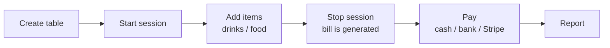
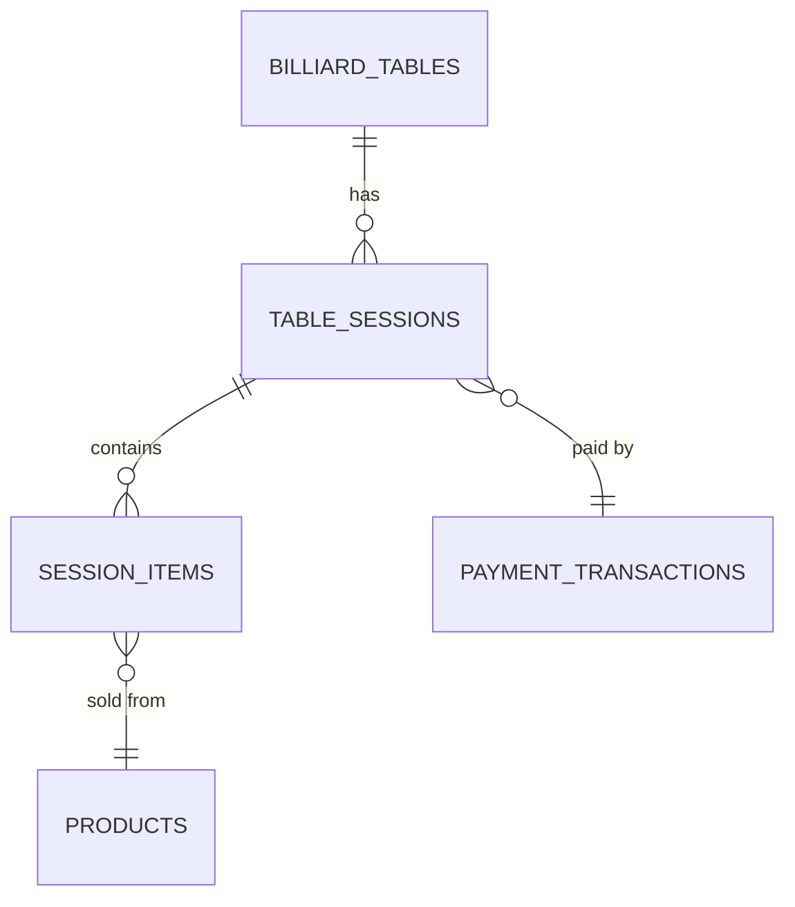
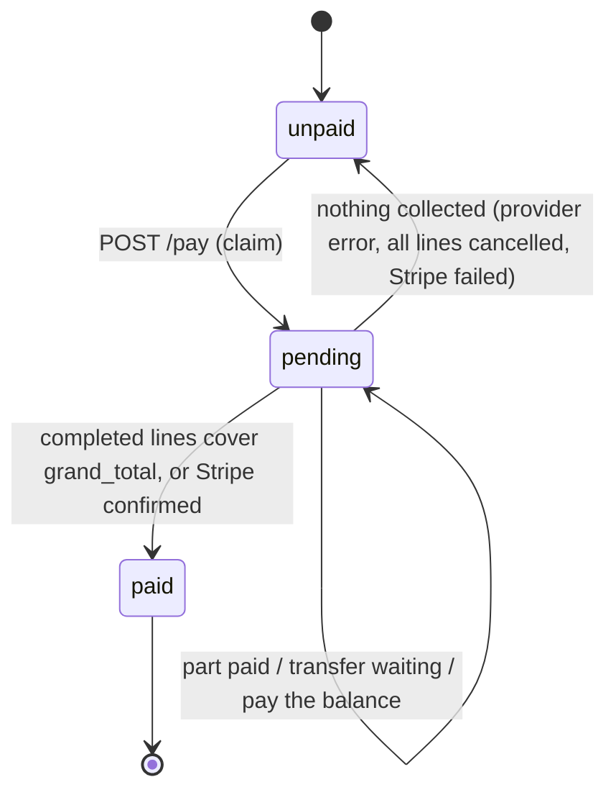

# Billiard (Bida) Module

Manage billiard tables, time-based billing, drinks/food orders, and payment for a club.

> **Status legend** used in this document
> - ✅ **Implemented**: exists in the code today.
> - 🗺️ **Planned**: designed but not built yet (see [Roadmap](#10-roadmap-not-implemented-yet)).

---

## 1. What this module does (in one minute)

A customer sits at a table. The cashier presses **Start**. The customer orders drinks. When they finish, the cashier presses **Stop** and the system prints a **bill**. The customer pays, and the cashier records the **payment**.



| Step | Endpoint | What happens |
|------|----------|--------------|
| Create table | `POST /tables` | Admin/Manager adds a table with an hourly rate |
| Start | `POST /tables/{id}/start` | Opens a session, table becomes `playing` |
| Add item | `POST /sessions/{id}/items` | Adds a product (price is frozen at this moment) |
| Stop | `POST /sessions/{id}/stop` | Calculates the fee, frees the table, returns the bill |
| Pay | `POST /sessions/{id}/pay` | Creates a payment through the Payments module |
| Confirm | `POST /sessions/{id}/pay/confirm` | Settles a gateway (Stripe) payment |
| Report | `GET /reports/tables/usage` | Revenue and usage per table |

---

## 2. Key concepts (glossary)

| Term | Meaning |
|------|---------|
| **Table** (`BilliardTable`) | A physical billiard table with a name, status, and hourly rate |
| **Session** (`TableSession`) | One customer's play period on one table, from Start to Stop. It is also the **bill** |
| **Item** (`SessionItem`) | One product line ordered during a session (e.g. 2 × Coca-Cola) |
| **Snapshot** | A value copied at a point in time so later changes don't affect it (rate, policy, product price) |
| **Billing policy** | The rule used to turn minutes into money (`per_minute` or `rounded_hour`) |
| **Tenant** | One club/business, identified by `client_id`. Tenants must never see each other's data |

---

## 3. Folder structure

```text
app/billiard/
├── config.py          # Billing policy, rounding, currency, payment method mapping
├── models/            # Database tables (SQLAlchemy)
│   ├── table.py       #   BilliardTable, TableStatus
│   ├── session.py     #   TableSession, SessionStatus, PaymentState
│   ├── game.py        #   TableGame, GameStatus
│   ├── pricing_rule.py#   PricingRule
│   └── device.py      #   Controller, event inbox, local ID map
├── schemas/           # Request/response shapes (Pydantic)
│   ├── table.py
│   ├── session.py
│   ├── game.py
│   ├── pricing.py
│   └── event.py
├── services/          # Business rules (the "brain")
│   ├── table_service.py     # create/list tables, start session, active tables
│   ├── session_service.py   # add item, stop, get bill
│   ├── payment_service.py   # pay + confirm (bridge to Payments module)
│   ├── report_service.py    # usage/revenue report
│   ├── game_service.py      # games and score changes
│   ├── pricing_rule_service.py # club/table time-based price rules
│   └── event_service.py     # idempotent ESP32 event ingestion/sync
├── routes/            # HTTP endpoints only (no business logic)
│   ├── table_router.py
│   ├── session_router.py
│   ├── report_router.py
│   ├── game_router.py
│   ├── pricing_router.py
│   └── controller_router.py
├── utils/
│   └── billing.py     # Pure functions: billable_minutes, calculate_table_fee
└── README.md
```

### Layer rules (please follow these)

```text
routes  →  services  →  models
(HTTP)     (rules)      (database)
```

- **Routes** only read the request, call a service, and return the response. No business rules here.
- **Services** hold the rules (validation, calculations, locking).
- **`utils/billing.py`** contains pure math with no database access, so it is easy to test.
- Services call `db.flush()`; the **route** calls `db.commit()`.
  - ⚠️ **Exception:** `payment_service.py` commits by itself. See [section 7](#7-payment-flow).

---

## 4. Data model



### `billiard_tables`

| Column | Type | Notes |
|--------|------|-------|
| `id` | int | Primary key |
| `name` | string(50) | Unique per `client_id` (checked in code) |
| `client_id` | string | Tenant owner |
| `status` | enum | `available`, `playing`, `reserved` |
| `hourly_rate` | decimal(12,2) | Current rate; **copied** into each new session |
| `created_at` | datetime | |

> `reserved` exists in the enum, but no endpoint sets it yet.

### `table_sessions`

| Column | Notes |
|--------|-------|
| `table_id` | Which table |
| `start_time`, `end_time` | UTC. `end_time` is empty while active |
| `status` | `active` or `completed` |
| `hourly_rate` | **Snapshot** of the table rate at Start |
| `billing_policy` | **Snapshot** of the policy at Start |
| `duration_minutes` | Filled at Stop |
| `total_table_fee` | Filled at Stop |
| `total_product_fee` | Sum of items, updated whenever an item is added |
| `grand_total` | `total_table_fee + total_product_fee` |
| `payment_state` | `unpaid` → `pending` → `paid` |
| `payment_method` | `cash`, `bank_transfer`, `stripe`, or `split` (several methods) |
| `payment_id`, `payment_reference` | Link to the Payments module (first completed line) |
| `paid_at` | When it was paid |
| `opened_by_id`, `stopped_by_id`, `paid_by_id` | Who did each action (audit) |

### `session_payments` (one row per payment line)

A bill can be paid by several lines, e.g. 200,000 cash + 110,000 transfer.

| Column | Notes |
|--------|-------|
| `session_id`, `method`, `amount` | `cash` or `bank_transfer`, and the part of the bill this line covers |
| `status` | `pending` (transfer waiting for the cashier), `completed`, `voided` (reversed by a manager), `cancelled` (never received), `failed` |
| `voided_at`, `voided_by_id`, `void_reason` | Set when a manager voids a completed line |
| `cash_tendered`, `change_given` | Cash only: money handed over and change returned |
| `transfer_memo`, `expires_at` | Transfer only: content to match in the bank feed (e.g. `BIDA42L7`) and QR expiry |
| `payment_id`, `payment_reference` | The backing `PaymentTransaction` in the Payments module |
| `created_by_id`, `confirmed_by_id`, `confirmed_at` | Who recorded / confirmed it |

### `session_payment_events` (audit trail)

Append-only log of every payment action: `line_created`, `cash_received`, `transfer_awaiting`, `transfer_confirmed`, `line_cancelled`, `line_failed`, `line_voided`, `transfer_auto_confirmed`, `transfer_assigned_from_bank`, `session_paid`, with the actor and a small JSON payload. Read it with `GET /sessions/{id}/pay/events`.

### `cash_shifts` and `cash_movements` (cash drawer)

One drawer per club (`client_id`): at most one shift is open at a time.

| Column | Notes |
|--------|-------|
| `cash_shifts.status` | `open` or `closed` |
| `opened_at`, `closed_at`, `opening_float` | The shift window and the cash already in the drawer |
| `expected_cash`, `counted_cash`, `variance` | Frozen at close. `variance = counted - expected` (negative = cash missing) |
| `cash_movements` | Pay-ins and pay-outs inside a shift, each with a reason and who did it |

**Upgrading an existing database:** run `python migrate_billiard_shifts.py` once. It creates the two new tables, adds the `voided_*` columns to `session_payments`, and on PostgreSQL adds the `voided` enum value. It is idempotent and backs up SQLite first. (A fresh database gets everything from `init_db`.)

### `session_items`

| Column | Notes |
|--------|-------|
| `session_id`, `product_id`, `variant_id` | What was sold |
| `product_name` | **Snapshot** of the name |
| `unit_price` | **Snapshot** of the price |
| `quantity`, `total_price` | `unit_price × quantity` |
| `added_by_id` | Who added it |

---

## 5. Business rules

### 5.1 Snapshots protect old bills

When a session starts, the **hourly rate** and **billing policy** are copied into the session. When an item is added, the **name and price** are copied into the item.

Why? If the owner changes a table rate or a product price tomorrow, yesterday's bill must **not** change. Bills and receipts are built only from the snapshot columns, never from `Product` or `BilliardTable`.

### 5.2 One active session per table

Two cashiers pressing **Start** at the same time must not open two sessions. We protect against this twice:

1. **Row lock** on the table (`with_for_update()`, effective on PostgreSQL).
2. **Unique partial index** `uq_one_active_session_per_table` in the database (works on SQLite and PostgreSQL too).

If the race happens, the loser receives `409 Table already has an active session`.

### 5.3 The table is freed at Stop, not at Pay

The bill is generated at Stop, so the table becomes `available` immediately. Payment can happen later; it settles an already-completed session.

### 5.4 Tenant isolation

Every query is scoped by `client_id` through `scope_tables()`:

- **SUPER_ADMIN** sees all clubs.
- **Everyone else** sees only their own `client_id`.
- Requests for another club's session return **404** (not 403), so we don't reveal that the id exists.

### 5.5 Money rules

- The client **never** sends an amount. Payment uses `session.grand_total`.
- All money uses `Decimal`, never `float` (the only `float` is the final conversion needed by `PaymentTransaction.amount`).

---

## 6. Billing calculation

Code: `utils/billing.py`.

### Step 1: billable minutes

```text
minutes = max(MIN_BILLABLE_MINUTES, ceil(seconds / 60))
```

Seconds are rounded **up** to the next whole minute (61 seconds → 2 minutes).

### Step 2: table fee (depends on the policy)

| Policy | Formula | Example: 135 min at 100,000/hour |
|--------|---------|----------------------------------|
| `per_minute` (default) | `rate × minutes / 60` | 100,000 × 2.25 = **225,000** |
| `rounded_hour` | `rate × ceil(minutes / 60)` | 100,000 × 3 = **300,000** |

Then the fee is rounded to `FEE_ROUNDING_UNIT` (for VND you may want `1000`) and quantized to 2 decimals.

### Step 3: grand total

```text
grand_total = total_table_fee + total_product_fee
```

### Full example

```text
Table 01, rate 100,000/hour, policy per_minute
09:00 → 11:15   (135 minutes)
Table fee:       225,000
Products:         85,000   (items added during play)
Grand total:     310,000
```

### Configuration (environment variables)

| Variable | Default | Meaning |
|----------|---------|---------|
| `BILLIARD_BILLING_POLICY` | `per_minute` | Policy for **new** sessions |
| `BILLIARD_MIN_BILLABLE_MINUTES` | `1` | Minimum minutes to charge |
| `BILLIARD_FEE_ROUNDING_UNIT` | `1` | Round the table fee to this unit (`1` = no rounding) |
| `BILLIARD_CURRENCY` | `VND` | Currency label on bills and payments |
| `BILLIARD_BANK_TRANSFER_REQUIRES_CONFIRMATION` | `true` | A transfer waits for the cashier's "received" tick. `false` = paid immediately (old behaviour) |
| `BILLIARD_TRANSFER_EXPIRE_MINUTES` | `15` | How long a transfer QR is shown as valid |
| `BILLIARD_BANK_BIN` | empty | NAPAS bank BIN of the receiving account (e.g. `970436`) |
| `BILLIARD_BANK_ACCOUNT_NO` | empty | Receiving account number |
| `BILLIARD_BANK_ACCOUNT_NAME` | empty | Account holder name (shown to the customer) |
| `BILLIARD_REQUIRE_OPEN_SHIFT` | `false` | `true` = `/pay` is refused (`409`) until a shift is open |
| `SEPAY_WEBHOOK_SECRET` | empty | HMAC secret for `POST /bank-feed/sepay` (preferred) |
| `SEPAY_API_KEY` | empty | API key alternative (`Authorization: Apikey ...`); endpoint is closed if neither is set |
| `SEPAY_TIMESTAMP_TOLERANCE_SECONDS` | `300` | Allowed clock difference for HMAC requests |
| `BILLIARD_BANK_CODE` | empty | Short bank code (e.g. `VCB`), only for the hosted QR image URL |

Without `BANK_BIN` + `BANK_ACCOUNT_NO` no QR is generated; a transfer line still works and the cashier confirms it by hand.

Changing these only affects **new** sessions because each session snapshots its own policy.

---

## 7. Payment flow

Payment reuses the existing **Payments** module through `payment_provider_registry`. Billiard does not talk to Stripe directly.

### Method mapping (`config.PAYMENT_METHODS`)

| API `payment_method` | Provider | Result |
|----------------------|----------|--------|
| `cash` | `manual` | Paid immediately. Optional `cash_tendered` records the money handed over and the change |
| `bank_transfer` | `manual` | `pending` with a VietQR until the cashier confirms (see below) |
| `stripe` | `stripe` | Stays `pending` until `/pay/confirm` |

### Request styles for `POST /sessions/{id}/pay`

Send **exactly one** of `payment_method` or `payments`:

```json
{"payment_method": "cash", "cash_tendered": 500000}
```

```json
{"payments": [
  {"method": "cash", "amount": 200000, "cash_tendered": 200000},
  {"method": "bank_transfer", "amount": 110000}
]}
```

- The bill total is never taken from the client. For a split, the line amounts must add up **exactly** to the amount due (`422` otherwise).
- `cash_tendered` must be at least the cash amount; `change_given` is calculated by the server.
- Up to 6 lines. Stripe cannot be mixed with cash/transfer lines.
- The bill (`GET /sessions/{id}`) shows `amount_paid`, `balance_due` and every line with its status.

### Bank transfer (VietQR)

1. `POST /pay` creates a `pending` transfer line with a memo like `BIDA42L7`. The response (and any later `GET /sessions/{id}`) has `payments[].transfer` with `qr_payload` (draw it as a QR code), `qr_image_url`, the memo, the amount, and `expires_at`.
2. The customer scans and pays.
3. The cashier presses "received": `POST /sessions/{id}/pay/lines/{line_id}/confirm`. The line becomes `completed`.
4. If the money never comes: `POST /sessions/{id}/pay/lines/{line_id}/cancel`. The line is voided and the remaining balance can be paid another way with a new `POST /pay`.

### Voiding a payment (managers only)

`POST /sessions/{id}/pay/lines/{line_id}/void` with a required `reason`. Only `manager`, `admin` and `super_admin` may call it (`403` for anyone else; the check is in both the route and the service).

- Only a `completed` line can be voided. A line still `pending` is cancelled instead.
- The line becomes `voided`, the backing payment is marked `refunded`, and `line_voided` is written to the audit trail with the manager and reason.
- The bill goes back to `pending` (part paid) or `unpaid`, `paid_at` / `paid_by` are cleared, and the cashier can take payment again.
- Stripe payments are not voided here (they have no payment lines); refund those through the Stripe refund endpoint.

### Shifts and the cash drawer

```text
POST /shifts/open        {"opening_float": 1000000}          start the shift (409 if one is open)
GET  /shifts/current                                          live totals, or null
POST /shifts/{id}/movements  {"type": "pay_out", "amount": 20000, "reason": "bought ice"}
POST /shifts/{id}/close  {"counted_cash": 1290000}           returns expected, counted, variance
GET  /shifts, GET /shifts/{id}
```

Expected cash in the drawer for the shift window:

```text
opening float
+ cash payments confirmed in the window     (the bill amount, change already netted out)
- cash payments voided in the window        (even if they were taken in an earlier shift)
+ pay-ins - pay-outs
```

- The summary also lists totals per method (received / voided / net), so bank transfers show up in the shift report but never in the drawer maths.
- A pay-out larger than the cash in the drawer is refused. A manager void can take the expected figure below zero (for example a refund the next day); that is shown as it is.
- Only the cashier who opened the shift, or a manager, can close it.
- A closed shift never changes: its numbers are frozen, and a later void counts in the shift in which it happens.
- By default payments are allowed with no shift open (they just don't appear in any shift). Set `BILLIARD_REQUIRE_OPEN_SHIFT=true` to enforce opening a shift first.

### Automatic confirmation of transfers (SePay)

Instead of the cashier pressing "received", the bank feed can confirm a transfer by itself. [SePay](https://developer.sepay.vn/en/sepay-webhooks) watches the club's bank account and calls `POST /bank-feed/sepay` for every incoming transfer.

**Set up**

1. In SePay, add a webhook pointing to `https://<your-api>/bank-feed/sepay` (HTTPS, public domain).
2. Choose the security method and set the matching variable on the server:
   - HMAC-SHA256 (preferred): `SEPAY_WEBHOOK_SECRET=<secret>`. Verifies `X-SePay-Signature` over `<X-SePay-Timestamp>.<raw body>` and rejects timestamps more than 5 minutes off.
   - API key: `SEPAY_API_KEY=<key>`. Verifies `Authorization: Apikey <key>`.
   - If neither is set the endpoint answers `503` and stays closed. If a secret is set, an API-key-only request is rejected.
3. Set `BILLIARD_BANK_ACCOUNT_NO` to the account SePay watches. Transfers to any other account are ignored.
4. Optional: in SePay *Company → General → Payment code structure* use the prefix `BIDA`. Matching does not depend on it, because we search the transfer content for our own code (`BIDA<session>L<line>`, any case, any surrounding text) and also check SePay's `code` field.

**What happens to each transaction**

Every transaction is stored first in `bank_transactions` (unique per SePay `id`, so replays are harmless), then matched:

| Result | When | What happens |
|--------|------|--------------|
| `matched` | Code found, line still `pending`, amount **exactly** equal | Line completes, bill settles, audit event `transfer_auto_confirmed` (no user) |
| `needs_review` | Code found but amount differs, line already paid (possible double transfer), or line cancelled/voided | Nothing is confirmed; a manager decides |
| `unmatched` | No bill code in the content, or the code matches no line | Kept for a manager |
| `ignored` | Outgoing transfer, or another account | Kept for audit |

The webhook always answers `{"success": true}` once a valid, authenticated transaction is stored, even when it could not be matched. SePay treats anything else as a failure and retries for up to 5 hours.

**Manager tools** (manager/admin only)

- `GET /bank-feed/transactions?status=needs_review` lists money that needs a decision.
- `POST /bank-feed/transactions/{id}/assign` `{"line_id": 7}` links a transaction to a pending transfer line and confirms it. The amount must match exactly (`422` otherwise): settle the difference with the customer first.
- `POST /bank-feed/transactions/{id}/ignore` `{"note": "refunded"}` dismisses it.

Unmatched transactions carry no club (the receiving account is global configuration), so every manager can see them; matched and `needs_review` ones are scoped to the club of their bill.

> **Not covered yet:** SePay only retries for 5 hours, so a webhook can be lost if the server is down longer. Their guidance is a job every 15-30 minutes that fetches recent transactions through the SePay API and feeds any missing ones through the same matcher. The cashier's manual "received" button still works as the fallback.

### Payment states



### Why there is a "claim"

The Payments providers call `db.commit()` themselves, so we cannot wrap everything in one transaction. Instead:

1. Lock the session, insert the payment lines, switch `unpaid → pending`, then **commit** (this is the *claim*).
2. Call the provider once per line. Any second `/pay` call while a line is waiting gets `409 A payment for this session is already in progress`.
3. Settle: `paid` when completed lines cover `grand_total`; `pending` while a transfer is waiting or a balance remains; back to `unpaid` if nothing was collected.
4. If recording a line fails, the failed and not-yet-processed lines are marked `failed`, the API returns `500`, and the bill shows exactly what was recorded. Cash that was already recorded stays; pay the remaining balance with a new `POST /pay`.

Pre-conditions for `/pay`: the session must be `completed`, not already `paid`, and `grand_total > 0`.

> If a payment is created but saving the session fails, an error is logged. The payment's metadata contains `billiard_session_id` (and `line_id`) so it can be reconciled by hand.

### Stripe example

```text
1. POST /sessions/42/pay          {"payment_method": "stripe"}
   → response has gateway.client_secret  (frontend completes the card payment)
2. POST /sessions/42/pay/confirm
   → backend asks Stripe; if succeeded, payment_state becomes "paid"
```

---

## 8. API reference

All endpoints require a logged-in user (JWT). Roles are noted where required.

### Tables

| Method | Path | Role | Description |
|--------|------|------|-------------|
| `POST` | `/tables` | ADMIN, MANAGER | Create a table. `409` if the name already exists |
| `GET` | `/tables` | any user | List tables (tenant-scoped) |
| `GET` | `/tables/active` | any user | Tables being played now, with live elapsed time and running total |
| `POST` | `/tables/{table_id}/start` | any user | Start a session. `404` unknown table, `409` not available |

### Sessions

| Method | Path | Description |
|--------|------|-------------|
| `GET` | `/sessions/{id}` | Get the bill/receipt (also works after payment) |
| `POST` | `/sessions/{id}/items` | Add an item. `409` if the session is not active |
| `POST` | `/sessions/{id}/stop` | Stop and return the bill. `409` if already completed |
| `POST` | `/sessions/{id}/pay` | Pay: single method or split lines (see section 7) |
| `POST` | `/sessions/{id}/pay/confirm` | Settle a gateway (Stripe) payment |
| `POST` | `/sessions/{id}/pay/lines/{line_id}/confirm` | Cashier confirms a bank transfer line was received |
| `POST` | `/sessions/{id}/pay/lines/{line_id}/cancel` | Void a pending line; the balance can be paid another way |
| `POST` | `/sessions/{id}/pay/lines/{line_id}/void` | **Manager only.** Reverse a completed line (reason required) |
| `GET` | `/sessions/{id}/pay/events` | Audit trail of payment actions |

### Shifts (cash drawer)

| Method | Path | Description |
|--------|------|-------------|
| `POST` | `/shifts/open` | Open a shift with an opening float. `409` if one is open |
| `GET` | `/shifts/current` | The open shift with live drawer totals, or `null` |
| `GET` | `/shifts` | Recent shifts (`limit`, `offset`) |
| `GET` | `/shifts/{id}` | Shift summary: drawer maths, per-method totals, movements |
| `POST` | `/shifts/{id}/movements` | Pay-in / pay-out with a reason |
| `POST` | `/shifts/{id}/close` | Close with the counted cash; returns the variance |

### Bank feed (SePay)

| Method | Path | Auth | Description |
|--------|------|------|-------------|
| `POST` | `/bank-feed/sepay` | SePay HMAC or API key | Webhook for incoming transfers (see section 7) |
| `GET` | `/bank-feed/transactions` | manager | List bank transactions; filter with `?status=` |
| `POST` | `/bank-feed/transactions/{id}/assign` | manager | Link a transaction to a pending transfer line and confirm it |
| `POST` | `/bank-feed/transactions/{id}/ignore` | manager | Dismiss a transaction |

### Games, pricing, and controller

| Method | Path | Description |
|--------|------|-------------|
| `GET` | `/sessions/{id}/games` | List the session's games in order |
| `POST` | `/sessions/{id}/games` | Start a game; billing keeps running |
| `POST` | `/games/{id}/score` | Apply a validated score delta |
| `POST` | `/games/{id}/reset`, `/new`, `/finish` | Reset, continue with a new game, or finish it |
| `GET` | `/billiard/pricing-rules/quote` | Preview a price for a table, start time, and duration |
| `GET/POST/PUT/DELETE` | `/billiard/pricing-rules` | Manage price rules (manager/admin writes) |
| `GET` | `/billiard/controller/state` | Authenticated controller snapshot after reconnect/reboot |
| `POST` | `/billiard/controller/events` | Ingest one authenticated controller event |
| `POST` | `/billiard/controller/sync` | Replay an offline controller queue idempotently |

### Reports

| Method | Path | Role | Description |
|--------|------|------|-------------|
| `GET` | `/reports/tables/usage?start_date=&end_date=` | ADMIN, MANAGER | Usage and revenue per table |

Report notes:

- Date filters apply to the session's `end_time`.
- Tables with zero sessions still appear (the filter is in the JOIN).
- `table_revenue`, `product_revenue`, `total_revenue` count **paid** sessions only.
- `unpaid_total` = completed sessions that are not yet paid.

### Request examples

```bash
# 1. Create a table (admin/manager)
curl -X POST http://localhost:8000/tables \
  -H "Authorization: Bearer <token>" -H "Content-Type: application/json" \
  -d '{"name": "Table 01", "hourly_rate": 100000}'

# 2. Start a session on table 1
curl -X POST http://localhost:8000/tables/1/start -H "Authorization: Bearer <token>"

# 3. Add 2 items of product 5 to session 1
curl -X POST http://localhost:8000/sessions/1/items \
  -H "Authorization: Bearer <token>" -H "Content-Type: application/json" \
  -d '{"product_id": 5, "quantity": 2}'

# 4. Stop and get the bill
curl -X POST http://localhost:8000/sessions/1/stop -H "Authorization: Bearer <token>"

# 5. Pay with cash (customer hands over 500,000, change is calculated)
curl -X POST http://localhost:8000/sessions/1/pay \
  -H "Authorization: Bearer <token>" -H "Content-Type: application/json" \
  -d '{"payment_method": "cash", "cash_tendered": 500000}'

# 5b. Or split: part cash, part bank transfer (the transfer line returns a VietQR)
curl -X POST http://localhost:8000/sessions/1/pay \
  -H "Authorization: Bearer <token>" -H "Content-Type: application/json" \
  -d '{"payments": [{"method": "cash", "amount": 200000}, {"method": "bank_transfer", "amount": 110000}]}'

# 5c. Cashier confirms the transfer arrived
curl -X POST http://localhost:8000/sessions/1/pay/lines/2/confirm -H "Authorization: Bearer <token>"
```

### Common error codes

| Code | Typical reason |
|------|----------------|
| `400` | Product inactive, or variant doesn't belong to the product |
| `404` | Table/session/product not found, or belongs to another tenant |
| `409` | Wrong state: table busy, session already stopped, already paid, payment in progress, nothing to pay |
| `403` | Voiding a payment without a manager role, or closing someone else's shift as a cashier |
| `422` | Split lines don't add up to the amount due, or cash tendered is less than the cash amount |

---

## 9. How other modules are used

| Module | How billiard uses it |
|--------|----------------------|
| **User/Auth** | `get_current_user`, `require_roles`, `client_id` for tenant scope, user ids for audit columns |
| **Product** | `Product` / `ProductVariant` supply the name and price **once**, at the time an item is added |
| **Payments** | `payment_provider_registry` creates and confirms the payment |

Product and Payments remain the source of truth for their own data. Billiard only stores references and snapshots.

---

## 10. Roadmap (not implemented yet)

🗺️ The items below are the **remaining target design**. The module already
implements games/scores, pricing rules, controller device authentication,
idempotent event ingestion, local-to-server ID mapping, and controller state
snapshots. See the API routers and tests for those current capabilities.

| Feature | Idea |
|---------|------|
| **WebSocket POS updates** | Push controller/table/session/game changes to the POS instead of polling |
| **RS485 firmware** | Controller firmware and the physical display/button protocol |
| **Packages** | Finish package CRUD, package selection at session start, included-item consumption, and billing |
| **Reservations** | Endpoint to set a table to `reserved` |
| **Discounts** | A `discount` field on the session |
| **Cancelled sessions** | A `cancelled` status |
| **Real-time updates** | WebSocket push to the POS |

### Principle to keep when building the ESP32 part

> The ESP32 controls the **physical** side (buttons, display, local scores). FastAPI stays the **only authority** for billing, prices, payments, and history. The ESP32 must never decide the final bill.

---

## 11. Tips for new developers

1. **Start by reading** `utils/billing.py`, then `session_service.stop_session`. That is the heart of the module.
2. **Never read `Product.price` for an old bill.** Use the `SessionItem` snapshot.
3. **Always scope by tenant.** Use `scope_tables()` (tables) or the check in `get_locked_session()` (sessions).
4. **Use `get_locked_session()`** when changing a session so concurrent requests are serialized.
5. **Keep routes thin.** If you write an `if` about business rules in a router, move it to a service.
6. **Use `Decimal`** for money. Convert numbers with `Decimal(str(value))`, not `Decimal(float)`.
7. **SQLite returns naive datetimes.** Use `as_utc()` from `utils/billing.py` before doing date math.
8. **Adding a new payment method?** Add it to `PAYMENT_METHODS` in `config.py` and to the `Literal` in `PaySessionRequest`. The provider must already exist in `payment_provider_registry`.
9. **Changing a table schema?** Add a migration for deployed databases. `python -m app.init_db` only creates *missing* tables; it does not alter existing ones.
