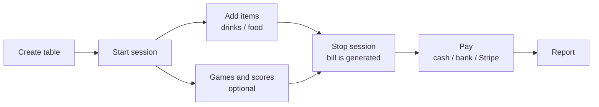
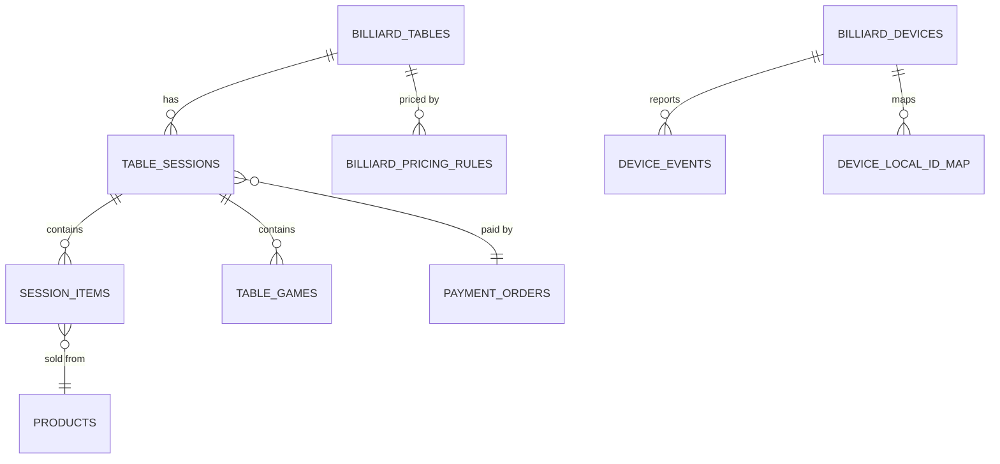

# Billiard (Bida) Module

Manage billiard tables, time-based billing, drinks/food orders, games and scores, an offline-capable table controller (ESP32), and payment for a club.

> **Status legend** used in this document
> - ✅ **Implemented**: exists in the code today.
> - 🗺️ **Planned**: designed but not built yet (see [Roadmap](#11-roadmap-not-implemented-yet)).

---

## 1. What this module does (in one minute)

A customer sits at a table. The cashier presses **Start**. The customer orders drinks and plays one or more games (scores are tracked). When they finish, the cashier presses **Stop** and the system prints a **bill**. The customer pays, and the cashier records the **payment**.



| Step | Endpoint | What happens |
|------|----------|--------------|
| Create table | `POST /tables` | Admin/Manager adds a table with an hourly rate |
| Start | `POST /tables/{id}/start` | Opens a session, table becomes `playing`. The price rule is chosen and frozen now |
| Add item | `POST /sessions/{id}/items` | Adds a product (price is frozen at this moment) |
| Play | `POST /sessions/{id}/games`, `/games/{id}/score` | Optional scoreboard. Billing keeps running |
| Stop | `POST /sessions/{id}/stop` | Calculates the fee, closes the running game, frees the table, returns the bill |
| Pay | `POST /sessions/{id}/pay` | Creates a payment through the Payments module |
| Confirm | `POST /sessions/{id}/pay/confirm` | Settles a gateway (Stripe) payment |
| Report | `GET /reports/tables/usage` | Revenue and usage per table |

The ESP32 controller can do the same start, game, score and stop steps while the club is offline, then replay them with `POST /billiard/controller/sync` (see [section 8](#8-controller-esp32-and-offline-sync)).

---

## 2. Key concepts (glossary)

| Term | Meaning |
|------|---------|
| **Table** (`BilliardTable`) | A physical billiard table with a name, status, and hourly rate |
| **Session** (`TableSession`) | One customer's play period on one table, from Start to Stop. It is also the **bill** |
| **Game** (`TableGame`) | One game inside a session, with a score for player A and player B. A session has many games; only one is active at a time |
| **Item** (`SessionItem`) | One product line ordered during a session (e.g. 2 × Coca-Cola) |
| **Pricing rule** (`PricingRule`) | A configurable way to price table time: per minute, per started hour, in blocks, or with a minimum. Can be limited to a table, days and a time window |
| **Snapshot** | A value copied at a point in time so later changes don't affect it (rate, pricing rule, product price) |
| **Billing policy / rule type** | The formula that turns minutes into money (`per_minute`, `hourly`, `block`, `minimum_hour`) |
| **Controller** (`BilliardDevice`) | The single central ESP32 that runs all table scoreboards. It has its own API key, not a user login |
| **Device event** (`DeviceEvent`) | One thing the controller reports (score change, session start, ...). Stored once, applied once |
| **Tenant** | One club/business, identified by `client_id`. Tenants must never see each other's data |

---

## 3. Folder structure

```text
app/billiard/
├── config.py          # Billing policy, rounding, currency, timezone, device clock limits
├── models/            # Database tables (SQLAlchemy)
│   ├── _common.py     #   enum_col helper (stores enum values, not names)
│   ├── table.py       #   BilliardTable, TableStatus
│   ├── session.py     #   TableSession, SessionStatus, PaymentState
│   ├── session_item.py#   SessionItem
│   ├── game.py        #   TableGame, GameStatus
│   ├── pricing_rule.py#   PricingRule, PricingRuleType
│   ├── package.py     #   BilliardPackage, BilliardPackageItem (tables only, no API yet)
│   └── device.py      #   Controller, event inbox, local ID map
├── schemas/           # Request/response shapes (Pydantic)
│   ├── table.py
│   ├── session.py
│   ├── game.py
│   ├── pricing.py
│   ├── event.py
│   ├── device.py
│   └── report.py
├── services/          # Business rules (the "brain")
│   ├── table_service.py        # create/update/deactivate/list tables, start session, active tables
│   ├── session_service.py      # add item, stop, get bill
│   ├── game_service.py         # game rules and score changes (POS path)
│   ├── billing_service.py      # picks the pricing rule, computes the table fee from the session snapshot
│   ├── pricing_rule_service.py # CRUD for price rules (tenant scoped)
│   ├── table_lifecycle.py      # the ONLY writer of BilliardTable.status
│   ├── session_lifecycle.py    # the ONLY place that opens/finalizes a session (POS and device share it)
│   ├── game_lifecycle.py       # the ONLY place that creates games or writes game status/end_time
│   ├── event_service.py        # idempotent ESP32 event ingestion and apply
│   ├── device_auth.py          # controller API-key check (X-Device-Id / X-Device-Key)
│   ├── device_service.py       # controller state snapshot, status, register
│   ├── payment_adapter.py      # billiard's side of the Payments contract (what to charge, which club)
│   ├── payment_service.py      # thin entry point: session id -> Payments module
│   └── report_service.py       # usage/revenue report
├── routes/            # HTTP endpoints only (no business logic)
│   ├── table_router.py
│   ├── session_router.py
│   ├── game_router.py
│   ├── pricing_router.py
│   ├── controller_router.py
│   └── report_router.py
├── utils/
│   └── billing.py     # Pure functions: billable_minutes, calculate_fee
└── README.md
```

### Layer rules (please follow these)

```text
routes  →  services  →  lifecycle helpers  →  models
(HTTP)     (rules)      (state changes)        (database)
```

- **Routes** only read the request, call a service, and return the response. No business rules here.
- **Services** hold the rules (validation, calculations, locking).
- **Lifecycle modules** (`table_lifecycle`, `game_lifecycle`, `session_lifecycle`) are the only code allowed to change table status, game status, or create/close a session. Both the POS path and the device path call them, so a bill is identical whichever way the session ran. Never assign `table.status` or `game.status` anywhere else. They import no other service (so there is no import cycle), never commit and never lock: the caller holds the row locks.
- **`utils/billing.py`** contains pure math with no database access, so it is easy to test.
- Services call `db.flush()`; the **route** calls `db.commit()`.
  - ⚠️ **Exceptions:** `payment_service.py` commits, because the Payments module does (see [section 7](#7-payments)). `event_service.py` commits once per device event, so each event is acknowledged independently.

---

## 4. Data model



### `billiard_tables`

| Column | Type | Notes |
|--------|------|-------|
| `id` | int | Primary key |
| `name` | string(50) | Unique per `client_id` (checked in code, backed by a unique index) |
| `client_id` | string | Tenant owner |
| `status` | enum | `available`, `playing`, `reserved`, `maintenance` |
| `hourly_rate` | decimal(12,2) | Current rate; **copied** into each new session |
| `is_active` | bool | `false` = retired table. Hidden from `GET /tables`, history is kept (sessions use `RESTRICT`) |
| `created_at`, `updated_at` | datetime | |

> `reserved` and `maintenance` exist in the enum, but no endpoint sets them yet. A table in either state cannot be started (`409`).

### `table_sessions`

| Column | Notes |
|--------|-------|
| `table_id` | Which table |
| `start_time`, `end_time` | UTC. `end_time` is empty while active |
| `start_time_source`, `end_time_source` | `server` or `device` (who produced the timestamp) |
| `ends_at` | Countdown target for timed play. Column and controller state exist, but nothing sets it yet |
| `status` | `active`, `completed` or `cancelled` (nothing sets `cancelled` yet) |
| `hourly_rate` | **Snapshot** of the rate used for this session (the table rate, or the matched rule's rate) |
| `billing_policy` | **Snapshot** of the rule type used (`per_minute`, `hourly`, `block`, `minimum_hour`; old rows may hold `rounded_hour`) |
| `pricing_snapshot` | **Snapshot** (JSON) of the rule: `rule_id`, `rule_name`, `rule_type`, `hourly_rate`, `params`, `priced_at`. Empty on old sessions |
| `package_id`, `package_name`, `package_price` | Reserved for packages (not used yet) |
| `duration_minutes` | Filled at Stop |
| `total_table_fee` | Filled at Stop |
| `total_product_fee` | Sum of items, updated whenever an item is added |
| `discount` | Column exists, **not applied yet**: `grand_total` ignores it |
| `grand_total` | `total_table_fee + total_product_fee` |
| `payment_order_id` | The bill in the Payments module (lines, transfers, audit live there) |
| `payment_state` | `unpaid` → `pending` → `paid`. **A mirror** of the order, written by the Payments module, so reports never join its tables |
| `payment_method` | Mirror: `cash`, `bank_transfer`, `stripe`, or `split` |
| `payment_id`, `payment_reference` | Mirror: link to the first completed payment |
| `paid_at`, `paid_by_id` | Mirror: when and by whom (empty `paid_by_id` = confirmed automatically by the bank feed) |
| `opened_by_id`, `stopped_by_id` | Who did each action (audit). Empty when the controller did it |

A partial unique index (`uq_one_active_session_per_table`) allows only one `active` session per table.

### `table_games`

| Column | Notes |
|--------|-------|
| `session_id` | The session (cascade delete) |
| `game_number` | 1, 2, 3 ... unique per session |
| `start_time`, `end_time` | UTC. Never earlier than the session start; `end_time` never before `start_time` |
| `player_a_score`, `player_b_score` | Never negative (CHECK constraint and a guarded UPDATE) |
| `status` | `active`, `completed`, `cancelled` |

A partial unique index (`uq_one_active_game_per_session`) allows only one `active` game per session.

### `session_items`

| Column | Notes |
|--------|-------|
| `session_id`, `product_id`, `variant_id` | What was sold. Product and variant are nullable (`SET NULL`), so deleting a product never breaks a receipt |
| `product_name` | **Snapshot** of the name |
| `unit_price` | **Snapshot** of the price |
| `quantity`, `total_price` | `unit_price × quantity` |
| `added_by_id` | Who added it |

### `billiard_pricing_rules`

| Column | Notes |
|--------|-------|
| `client_id`, `table_id` | Tenant. `table_id` empty = applies to every table of the club |
| `name`, `rule_type` | `per_minute`, `hourly`, `block`, `minimum_hour` |
| `hourly_rate` | Optional. Overrides the table's rate (e.g. a weekend rate) |
| `params` | `block`: `{"block_minutes": 1..1440}`. `minimum_hour`: `{"min_minutes": 1..1440}`. Other keys are dropped |
| `days_of_week`, `start_time`, `end_time` | Optional window in **club-local time**. `start_time` and `end_time` come together. A window like 22:00 → 02:00 is allowed |
| `priority`, `is_active` | Higher priority wins. Inactive rules are ignored |

### Controller tables

| Table | Purpose |
|-------|---------|
| `billiard_devices` | The central controller: `device_id`, `api_key_hash` (the raw key is never stored), `status`, `firmware_version`, `last_seen`, `last_applied_seq` |
| `device_events` | Every event the controller sent, stored once (`event_id` unique, `device_seq` unique per device) with a status: `received`, `processed`, `rejected`, `conflict`. Never auto-deleted |
| `device_local_id_map` | `LOCAL-S-...` / `LOCAL-G-...` ids the controller used offline → the real session/game ids |

### Packages (model only)

`billiard_packages` and `billiard_package_items` exist (duration, price, included products), but there is no API, no selection at session start and no billing logic yet. See the [Roadmap](#11-roadmap-not-implemented-yet).

### Payment tables are not here

Payment lines, the audit trail, cash shifts and bank transactions belong to the **Payments module**
(`payment_orders`, `payment_lines`, `payment_events`, `cash_shifts`, `bank_transactions`). See
[`app/payments/README.md`](../payments/README.md). A session only stores `payment_order_id` and the mirror columns above.

---

## 5. Business rules

### 5.1 Snapshots protect old bills

When a session starts, the **hourly rate**, the **rule type** and the **rule parameters** are copied into the session. When an item is added, the **name and price** are copied into the item.

Why? If the owner changes a table rate, edits or deletes a pricing rule, or changes a product price tomorrow, yesterday's bill must **not** change. Bills and receipts are built only from the snapshot columns, never from `Product`, `BilliardTable` or `PricingRule`.

### 5.2 One active session per table, one active game per session

Two cashiers pressing **Start** at the same time must not open two sessions. We protect against this twice:

1. **Row lock** on the table (`with_for_update()`, effective on PostgreSQL).
2. **Unique partial index** `uq_one_active_session_per_table` in the database (works on SQLite and PostgreSQL too).

If the race happens, the loser receives `409 Table already has an active session`. A table that is not `available` is refused earlier with `409 Table is <status>` (for example `Table is playing`) or `409 Table is inactive`.

Games work the same way: `uq_one_active_game_per_session` plus the session row lock, so two games can never run at once in a session.

### 5.3 The table is freed at Stop, not at Pay

The bill is generated at Stop, so the table becomes `available` immediately. Payment can happen later; it settles an already-completed session. Stopping a session also closes its running game.

### 5.4 Tenant isolation

Every query is scoped by `client_id` through `scope_tables()` (tables), `get_locked_session()` (sessions) or `_scope()` (pricing rules):

- **SUPER_ADMIN** sees all clubs.
- **Everyone else** sees only their own `client_id`.
- Requests for another club's session, game or rule return **404** (not 403), so we don't reveal that the id exists.

### 5.5 Money rules

- The client **never** sends an amount. Payment uses `session.grand_total`.
- All money uses `Decimal`, never `float` (the only `float` is the final conversion needed by `PaymentTransaction.amount`).

### 5.6 Games never touch billing

Starting, finishing or resetting a game does not change the session timer, the rate or the totals. **New game** completes the current game and opens the next one at 0 : 0 inside the same session. Score changes are single atomic `UPDATE`s with a `>= 0` guard, so a score can never go negative, even with concurrent button presses.

### 5.7 Who writes status

`table_lifecycle`, `game_lifecycle` and `session_lifecycle` are the only writers of table status, game status and session start/stop. The POS routes and the controller's event handlers both go through them. `table_lifecycle.find_inconsistencies()` reports any drift between `table.status` and `session.status`.

---

## 6. Billing calculation

Code: `utils/billing.py` (the math) and `services/billing_service.py` (which rule to use).

### Step 1: choose the pricing rule (once, at Start)

`billing_service.select_rule` looks at the rules of the club that are active, apply to this table (or to every table), and whose days and time window match the **start time in club-local time** (`BILLIARD_TIMEZONE`). If several match, the winner is:

1. the highest `priority`, then
2. a rule for this specific table over an all-tables rule, then
3. the newest rule (highest id).

The rule is chosen **once**. A session that runs past the end of a happy-hour window keeps the happy-hour rate. If no rule matches, the table's own `hourly_rate` and the default policy from `BILLIARD_BILLING_POLICY` are used. The chosen rate, rule type and parameters are frozen into the session (`hourly_rate`, `billing_policy`, `pricing_snapshot`).

### Step 2: billable minutes

```text
minutes = max(MIN_BILLABLE_MINUTES, ceil(seconds / 60))
```

Seconds are rounded **up** to the next whole minute (61 seconds → 2 minutes).

### Step 3: table fee (depends on the rule type)

| Rule type | Formula | Example: 135 min at 100,000/hour |
|-----------|---------|----------------------------------|
| `per_minute` (default) | `rate × minutes / 60` | 100,000 × 2.25 = **225,000** |
| `hourly` (old name `rounded_hour`) | `rate × ceil(minutes / 60)` | 100,000 × 3 = **300,000** |
| `block` (`block_minutes`, default 60) | `rate × block_minutes / 60 × ceil(minutes / block_minutes)` | 30-minute blocks: 50,000 × 5 = **250,000** |
| `minimum_hour` (`min_minutes`, default 60) | `rate × max(minutes, min_minutes) / 60` | **225,000** (a 20-minute game would still cost 100,000) |

Then the fee is rounded to `FEE_ROUNDING_UNIT` (for VND you may want `1000`) and quantized to 2 decimals.

### Step 4: grand total

```text
grand_total = total_table_fee + total_product_fee
```

(`discount` is not subtracted yet.)

### Live total and price preview

`GET /tables/active` and the final bill use the **same** function (`billing_service.table_fee`) on the session's own snapshot, so the running total always matches what Stop will produce. `GET /billiard/pricing-rules/quote` previews a price for a table, start time and duration without writing anything.

### Full example

```text
Table 01, rate 100,000/hour, rule type per_minute
09:00 → 11:15   (135 minutes)
Table fee:       225,000
Products:         85,000   (items added during play)
Grand total:     310,000
```

### Configuration (environment variables)

| Variable | Default | Meaning |
|----------|---------|---------|
| `BILLIARD_BILLING_POLICY` | `per_minute` | Rule type for **new** sessions when no pricing rule matches (`per_minute` or `rounded_hour`) |
| `BILLIARD_MIN_BILLABLE_MINUTES` | `1` | Minimum minutes to charge |
| `BILLIARD_FEE_ROUNDING_UNIT` | `1` | Round the table fee to this unit (`1` = no rounding) |
| `BILLIARD_CURRENCY` | `VND` | Currency label on bills and payments |
| `BILLIARD_TIMEZONE` | `Asia/Ho_Chi_Minh` | The club's time zone. Report ranges, rule time windows and the `quote` `at` parameter (when sent without an offset) are read in this zone; stored times are UTC |
| `BILLIARD_MAX_CLOCK_AHEAD_SECONDS` | `120` | How far ahead of the server a controller timestamp may be before the event is rejected |
| `BILLIARD_MAX_OFFLINE_HOURS` | `48` | Controller timestamps older than this are rejected (too old to bill from the device clock) |

Payment settings (bank account, QR, SePay, shifts, transfer expiry, manual-confirm rules) are in the Payments module: see [`app/payments/README.md`](../payments/README.md#8-configuration).

Changing these only affects **new** sessions because each session snapshots its own rate and rule.

---

## 7. Payments

Billiard does **not** implement payment. It is a *payable business* of the Payments module
(`source_type = "billiard_session"`). Everything about how money is taken (cash and change, split,
VietQR, SePay bank feed, manager voids, shifts, audit trail, Stripe) lives in
[`app/payments`](../payments/README.md) and works the same for any business.

### What billiard contributes (`services/payment_adapter.py`)

| Question Payments asks | Billiard's answer |
|------------------------|-------------------|
| Find the object | `TableSession` by id, with a row lock and the tenant check (`404` for other clubs) |
| May it be paid now? | Only when the session is `completed` (stopped) |
| How much, which currency, which club? | `grand_total`, `BILLIARD_CURRENCY`, the table's `client_id` |
| What to put in each payment's metadata? | `billiard_session_id` and the table name, for reconciliation |
| Mirror the result | Writes `payment_order_id`, `payment_state`, `payment_method`, `paid_at`, `paid_by_id` onto the session |

The client never sends an amount: it is always `session.grand_total` at the moment of paying.

### Two ways to call it (same operation)

| Billiard URL | Generic Payments URL |
|--------------|----------------------|
| `POST /sessions/{id}/pay` | `POST /payments/orders/billiard_session/{id}/pay` |
| `POST /sessions/{id}/pay/confirm` | `POST /payments/orders/billiard_session/{id}/pay/confirm` |
| `POST /sessions/{id}/pay/lines/{line_id}/confirm` | `.../lines/{line_id}/confirm` |
| `POST /sessions/{id}/pay/lines/{line_id}/cancel` | `.../lines/{line_id}/cancel` |
| `POST /sessions/{id}/pay/lines/{line_id}/void` (manager) | `.../lines/{line_id}/void` |
| `GET /sessions/{id}/pay/events` | `.../events` |

The billiard URLs return the **bill** (`BillResponse`, with `amount_paid`, `balance_due` and the payment
lines); the Payments URLs return the order view. Request bodies are the same, for example:

```json
{"payment_method": "cash", "cash_tendered": 500000}
{"payments": [{"method": "cash", "amount": 200000}, {"method": "bank_transfer", "amount": 110000}]}
```

### Stripe example

```text
1. POST /sessions/42/pay          {"payment_method": "stripe"}
   -> response has gateway.client_secret  (frontend completes the card payment)
2. POST /sessions/42/pay/confirm
   -> backend asks Stripe; if succeeded, payment_state becomes "paid"
```

### Notes

- A session paid before the Payments module kept the bill has no order. It still shows as `paid`
  (`amount_paid = grand_total`, no lines) and cannot be paid again.
- Reports use `payment_state == "paid"` on the session, so they need no join with the Payments tables.
- The table is freed at Stop, so payment can happen later (see 5.3).
- A bank-transfer line that nobody confirms is **cancelled automatically** by a background job some time after its QR expires (default 60 minutes of grace). The bill then goes back to `unpaid` (or stays part paid) so the cashier can start over. Money that arrives later is kept for a manager.
- A cashier's manual "Received" tick can be restricted to managers and/or require a note, by configuration in the Payments module.

---

## 8. Controller (ESP32) and offline sync

One central ESP32 runs the scoreboards of every table. It may be offline for hours, so it keeps its own local state and a persistent event queue, then replays the queue when the network returns.

> **Principle:** the ESP32 controls the **physical** side (buttons, display, local scores). FastAPI stays the **only authority** for billing, prices, payments and history. The ESP32 never decides the final bill.

### Authentication

The controller does not use a user JWT. It sends two headers on every call:

```text
X-Device-Id:  BILLIARD-CONTROLLER-01
X-Device-Key: <api key shown once at registration>
```

Only a SHA-256 hash of the key is stored. A manager registers the controller with `POST /billiard/controller/register` (the raw key is returned **once**). The controller counts as `offline` after 90 seconds without a request.

### Event rules

- **Idempotency:** every event has a unique `event_id`. Replaying a processed event answers `duplicates`, never applies it twice. A rejected or conflicting event is **not** acknowledged as a duplicate, so the device keeps it.
- **Ordering:** events are applied in `device_seq` order (monotonic per device, survives reboot). Timestamps are never used for ordering because the ESP32 clock can be wrong offline.
- **Acknowledgement cursor:** `server_state_version` is the highest *contiguous* `device_seq` that was processed. The device may discard events up to there and must resend anything above it.
- **Device clock:** a timestamp is used only when `clock_synced` is true. More than `BILLIARD_MAX_CLOCK_AHEAD_SECONDS` in the future, or older than `BILLIARD_MAX_OFFLINE_HOURS`, rejects the event. Smaller skews are clamped (never in the future, never before the session start), so a bad clock cannot invent billable time. With no valid clock, server time is used.
- **Scores: the device wins.** While offline the controller is the source of truth for the scoreboard. The server records what the device reports and notes the overwritten value on the event (`reconciled`).
- **Sessions and games map, not duplicate.** If the POS already started a session (or game) on that table, the controller's `LOCAL-S-...` / `LOCAL-G-...` id is mapped to it instead of creating a second one.
- **Billing stays on the server.** The fee is computed by the same `session_lifecycle.finalize_stop` as a POS stop, from the session's own snapshot. A device `grand_total` is never read.
- **Failures are kept.** Rejected and conflicting events are stored with a message and never auto-deleted.

### Supported event types

| Event | Effect |
|-------|--------|
| `heartbeat` | Updates `last_seen` and firmware version |
| `session_start` | Opens a session (or adopts the existing one) |
| `session_stop` | Applies final scores, closes the game, bills and frees the table. Already-completed sessions keep their server billing |
| `game_start`, `new_game`, `game_end` | Opens / rotates / finishes a game |
| `score_change`, `score_reset` | Sets the scores reported by the device |
| `time_extend`, `button_press`, `table_status`, `device_error` | Stored as `rejected` ("No handler yet"), never silently dropped |

### Endpoints

Firmware endpoints use the device headers. `status`, `hydro-candidates` and `register` are for managers (JWT).

| Method | Path | Auth | Description |
|--------|------|------|-------------|
| `GET` | `/billiard/controller/state` | device | Server view of every active table (session, game, scores, `server_state_version`) for reboot and reconnect |
| `POST` | `/billiard/controller/events` | device | One live event. Same pipeline as `/sync` |
| `POST` | `/billiard/controller/sync` | device | Replay the offline queue (max 500 events). `403` if `device_id` differs from the credentials |
| `GET` | `/billiard/controller/status` | ADMIN, MANAGER | Controllers of the club with an effective online/offline status |
| `GET` | `/billiard/controller/hydro-candidates` | ADMIN, MANAGER | Existing hydro devices that could be registered as a controller |
| `POST` | `/billiard/controller/register` | ADMIN, MANAGER | Register a controller (by `device_id`, or copy it from a hydro device). Returns the API key once |

---

## 9. API reference

All endpoints require a logged-in user (JWT) except the controller firmware endpoints (device key). Roles are noted where required.

### Tables

| Method | Path | Role | Description |
|--------|------|------|-------------|
| `POST` | `/tables` | ADMIN, MANAGER | Create a table. `409` if the name already exists |
| `GET` | `/tables` | any user | List **active** tables (tenant-scoped) |
| `PATCH` | `/tables/{table_id}` | ADMIN, MANAGER | Change `name` and/or `hourly_rate`. `409` if the name is taken. The new rate applies to new sessions only |
| `DELETE` | `/tables/{table_id}` | ADMIN, MANAGER | **Deactivate** (not delete): `is_active=false`. `409` if the table has an active session or is already inactive. History is kept |
| `GET` | `/tables/active` | any user | Tables being played now, with live elapsed time and running total |
| `POST` | `/tables/{table_id}/start` | any user | Start a session. `404` unknown table, `409` not available (`Table is playing`, `Table is maintenance`, `Table is inactive`, or `Table already has an active session` on a race) |

### Sessions

| Method | Path | Description |
|--------|------|-------------|
| `GET` | `/sessions/{id}` | Get the bill/receipt (also works after payment) |
| `POST` | `/sessions/{id}/items` | Add an item. `409` if the session is not active |
| `POST` | `/sessions/{id}/stop` | Stop and return the bill. `409` if already completed |
| `POST` | `/sessions/{id}/pay` | Pay: single method or split lines (see section 7). Delegates to the Payments module |
| `POST` | `/sessions/{id}/pay/confirm` | Settle a gateway (Stripe) payment |
| `POST` | `/sessions/{id}/pay/lines/{line_id}/confirm` | Cashier confirms a bank transfer line was received (may need a note or a manager, by configuration) |
| `POST` | `/sessions/{id}/pay/lines/{line_id}/cancel` | Void a pending line; the balance can be paid another way |
| `POST` | `/sessions/{id}/pay/lines/{line_id}/void` | **Manager only.** Reverse a completed line (reason required) |
| `GET` | `/sessions/{id}/pay/events` | Audit trail of payment actions |

### Games

| Method | Path | Description |
|--------|------|-------------|
| `GET` | `/sessions/{id}/games` | List the session's games in order |
| `POST` | `/sessions/{id}/games` | Start a game (`201`); billing keeps running. `409` if the session is not active or a game is already running |
| `POST` | `/games/{id}/score` | Apply a score delta: `{"player": "A", "delta": 1}`. `delta` is -10 to 10, never 0. `409 Score cannot go below 0` |
| `POST` | `/games/{id}/reset` | Scores back to 0 : 0 |
| `POST` | `/games/{id}/new` | Complete this game and open the next at 0 : 0 (same session, same billing). Returns `{finished, started}` |
| `POST` | `/games/{id}/finish` | Complete this game without starting another |

### Pricing rules

| Method | Path | Role | Description |
|--------|------|------|-------------|
| `GET` | `/billiard/pricing-rules` | any user | List the club's rules (highest priority first) |
| `GET` | `/billiard/pricing-rules/quote?table_id=&minutes=&at=` | any user | Preview a price. Writes nothing. A naive `at` means club-local time |
| `POST` | `/billiard/pricing-rules` | ADMIN, MANAGER | Create a rule (`201`) |
| `PUT` | `/billiard/pricing-rules/{rule_id}` | ADMIN, MANAGER | Change a rule. The merged result is validated |
| `DELETE` | `/billiard/pricing-rules/{rule_id}` | ADMIN, MANAGER | Delete a rule. Existing bills are unaffected |

### Controller

See [section 8](#8-controller-esp32-and-offline-sync).

### Shifts, bank feed and generic orders

Moved to the Payments module: `/payments/shifts/*`, `/payments/bank-feed/*`, `/payments/orders/*`.
See [`app/payments/README.md`](../payments/README.md#9-api-reference).

### Reports

| Method | Path | Role | Description |
|--------|------|------|-------------|
| `GET` | `/reports/tables/usage?start_date=&end_date=` | ADMIN, MANAGER | Usage and revenue per table |

Report notes:

- Date filters apply to the session's `end_time` and only count `completed` sessions.
- Dates are read in the club's time zone. A date-only `end_date` (00:00:00) includes that whole day; the upper bound is exclusive internally so nothing is missed.
- Tables with zero sessions still appear (the filter is in the JOIN).
- `table_revenue`, `product_revenue`, `total_revenue` count **paid** sessions only.
- `unpaid_total` = completed sessions that are not yet paid.

### Request examples

```bash
# 1. Create a table (admin/manager)
curl -X POST http://localhost:8000/tables \
  -H "Authorization: Bearer <token>" -H "Content-Type: application/json" \
  -d '{"name": "Table 01", "hourly_rate": 100000}'

# 2. Start a session on table 1
curl -X POST http://localhost:8000/tables/1/start -H "Authorization: Bearer <token>"

# 3. Add 2 items of product 5 to session 1
curl -X POST http://localhost:8000/sessions/1/items \
  -H "Authorization: Bearer <token>" -H "Content-Type: application/json" \
  -d '{"product_id": 5, "quantity": 2}'

# 3b. Start a game and score a point for player A
curl -X POST http://localhost:8000/sessions/1/games -H "Authorization: Bearer <token>"
curl -X POST http://localhost:8000/games/1/score \
  -H "Authorization: Bearer <token>" -H "Content-Type: application/json" \
  -d '{"player": "A", "delta": 1}'

# 4. Stop and get the bill
curl -X POST http://localhost:8000/sessions/1/stop -H "Authorization: Bearer <token>"

# 5. Pay with cash (customer hands over 500,000, change is calculated)
curl -X POST http://localhost:8000/sessions/1/pay \
  -H "Authorization: Bearer <token>" -H "Content-Type: application/json" \
  -d '{"payment_method": "cash", "cash_tendered": 500000}'

# 5b. Or split: part cash, part bank transfer (the transfer line returns a VietQR)
curl -X POST http://localhost:8000/sessions/1/pay \
  -H "Authorization: Bearer <token>" -H "Content-Type: application/json" \
  -d '{"payments": [{"method": "cash", "amount": 200000}, {"method": "bank_transfer", "amount": 110000}]}'

# 5c. Cashier confirms the transfer arrived (or the SePay webhook does it automatically)
curl -X POST http://localhost:8000/sessions/1/pay/lines/2/confirm -H "Authorization: Bearer <token>"
```

### Common error codes

| Code | Typical reason |
|------|----------------|
| `400` | Product inactive, or variant doesn't belong to the product |
| `401` | Missing/expired token, or wrong controller key |
| `403` | Voiding a payment without a manager role; manager-only table, rule, report or controller actions; confirming a transfer by hand when that is restricted to managers |
| `404` | Table/session/game/rule/product not found, or belongs to another tenant |
| `409` | Wrong state: table busy or inactive, session already stopped, game not active, score below 0, already paid, payment in progress, nothing to pay |
| `422` | Split lines don't add up to the amount due, cash tendered is less than the cash amount, invalid rule fields, a required manual-confirm note is missing |

---

## 10. How other modules are used

| Module | How billiard uses it |
|--------|----------------------|
| **User/Auth** | `get_current_user`, `require_roles`, `client_id` for tenant scope, user ids for audit columns |
| **Product** | `Product` / `ProductVariant` supply the name and price **once**, at the time an item is added |
| **Payments** | Billiard registers a `PayableAdapter`; the Payments module takes the money (cash, split, VietQR, bank feed, void, shifts) and mirrors the state back |
| **Hydro system** | A controller can be registered by copying the id and name of an existing hydro device (`hydro-candidates`) |

Product and Payments remain the source of truth for their own data. Billiard only stores references, snapshots and the payment-state mirror.

---

## 11. Roadmap (not implemented yet)

🗺️ The items below are the **remaining target design**. Already built: tables (create, edit, deactivate), sessions, items, games and scores, pricing rules, controller authentication, idempotent event ingestion, local-to-server ID mapping, controller state snapshots, reports and payments.

| Feature | Idea |
|---------|------|
| **WebSocket POS updates** | Push controller/table/session/game changes to the POS instead of polling (`/tables/active` is polled today) |
| **RS485 firmware** | Controller firmware and the physical display/button protocol |
| **Packages** | The tables and session columns exist. Missing: package CRUD, package selection at session start, included-item consumption, package billing |
| **Reservations / maintenance** | Endpoints to set a table to `reserved` or `maintenance` (the statuses exist, nothing sets them) |
| **Discounts** | The `discount` column exists but `grand_total` ignores it |
| **Cancelled sessions** | The `cancelled` status exists, but no endpoint cancels a session |
| **Timed play** | `ends_at` exists and is sent to the controller, but nothing sets it |
| **More device events** | Handlers for `time_extend`, `button_press`, `table_status`, `device_error` (stored as rejected today) |
| **Offline heartbeat job** | `status` already shows offline after 90s; a background job could also record the change and alert |
| **Split bills across rate windows** | Today one rule covers the whole session. Splitting a bill across rate windows is a possible later change |

---

## 12. Tests

Run from the project root, for example `python -m pytest app/tests/test_game_service.py -v`.

| File | What it covers |
|------|----------------|
| `test_game_service.py` | Game numbering, one active game, scores up/down/never negative, new game keeps billing, tenant 404, clamped device clock, stop closes the game |
| `test_pricing_sessions.py` | Rule selection, happy hour, day windows, block pricing, snapshots survive rule edits, live total, bill rule name |
| `test_event_service.py` | Device score wins, duplicates, ordering by `device_seq`, rejected vs duplicate, contiguous cursor, authentication |
| `test_event_sessions.py` | Session/game start and stop from the controller, adopt existing sessions, clock rules, full offline replay, HTTP endpoints |
| `test_billiard_payments.py` | Billiard's side of payments: adapter rules, state mirror, legacy sessions, URLs |
| `test_payments_*.py`, `test_stripe_provider.py` | The Payments module itself (see its README) |

---

## 13. Tips for new developers

1. **Start by reading** `utils/billing.py`, then `billing_service.py` and `session_lifecycle.finalize_stop`. That is the heart of the module (`session_service.stop_session` just locks and calls it).
2. **Never read `Product.price` for an old bill.** Use the `SessionItem` snapshot. Never read `PricingRule` for an old bill either: use the session's `pricing_snapshot`.
3. **Always scope by tenant.** Use `scope_tables()` (tables), the check in `get_locked_session()` (sessions) or `pricing_rule_service._scope()` (rules).
4. **Use `get_locked_session()`** when changing a session (and games: `game_service` locks the session first) so concurrent requests are serialized.
5. **Never write `table.status`, `game.status` or open/close a session by hand.** Call the lifecycle helpers so the POS and the controller stay consistent.
6. **Keep routes thin.** If you write an `if` about business rules in a router, move it to a service.
7. **Use `Decimal`** for money. Convert numbers with `Decimal(str(value))`, not `Decimal(float)`.
8. **SQLite returns naive datetimes.** Use `as_utc()` from `utils/billing.py` before doing date math.
9. **Never trust the controller for money.** Read scores and times from events, never `grand_total`, fees or rates. Order events by `device_seq`, not by timestamp.
10. **Adding a new payment method?** Add it to `PAYMENT_METHODS` in `app/payments/config.py` and to the `Literal` in `PayOrderRequest` (`app/payments/schemas/order.py`). The provider must already exist in `payment_provider_registry`.
11. **Adding a new pricing rule type?** Add it to `PricingRuleType`, to `calculate_fee` in `utils/billing.py`, and to `normalize_params` in `schemas/pricing.py`, then add a test in `test_pricing_sessions.py`.
12. **Changing a table schema?** Add a migration for deployed databases. `python -m app.init_db` only creates *missing* tables; it does not alter existing ones.