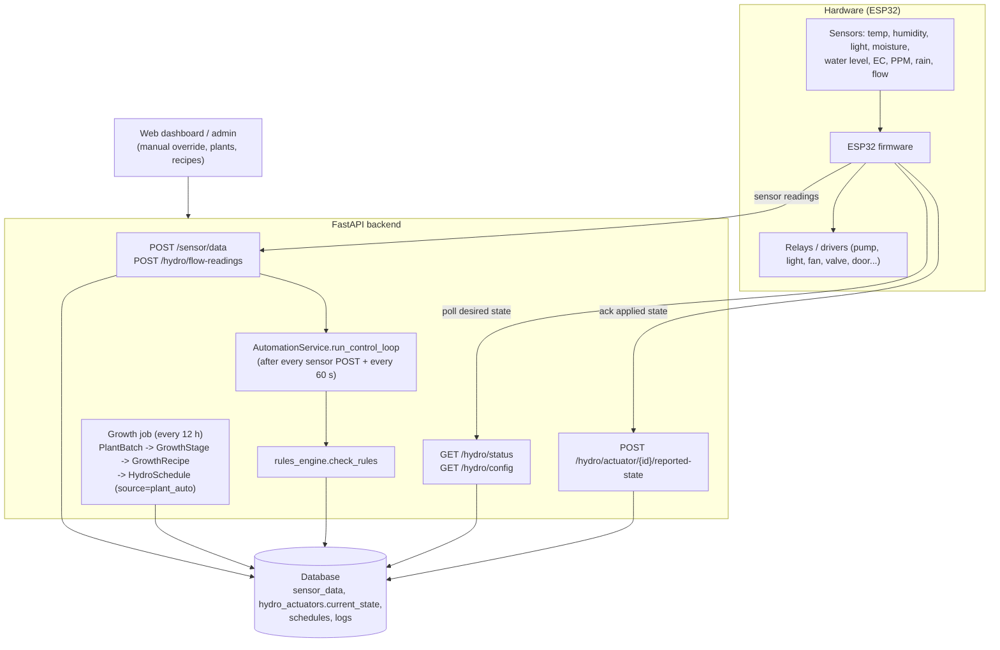
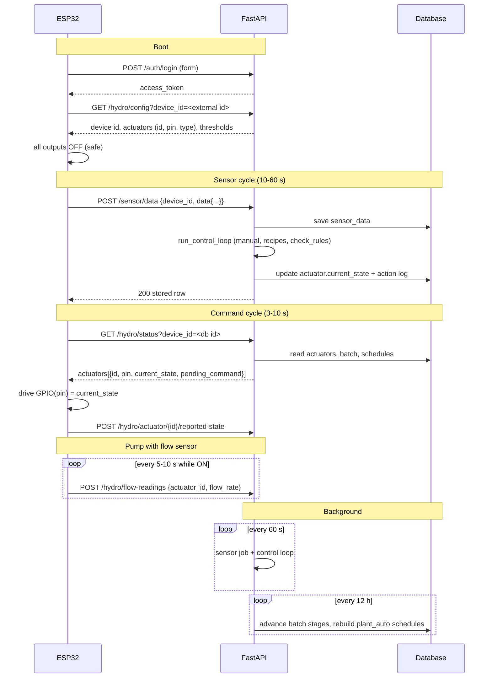

# Hydroponic System: ESP32 Integration Guide (FastAPI backend)

This guide explains how **any ESP32** (MicroPython, Arduino/PlatformIO, ESP-IDF) connects to the hydroponic backend. The firmware only needs HTTP + JSON. The backend decides *what* every actuator should do; the ESP32 reports sensors and applies the result to its relays.

> **One rule to remember:** the ESP32 never evaluates schedules, thresholds, recipes or rain logic. It sends sensor data, polls the desired state of each actuator, and drives the GPIO pins to match.

---

## 1. Architecture



Desired actuator state lives in the database (`hydro_actuators.current_state`). There is no in-memory `state_manager` any more.

### Who decides what

| Component | Responsibility |
| --- | --- |
| ESP32 | Read sensors, `POST` them, poll `current_state`, drive GPIO, acknowledge |
| `run_control_loop` | Load the device's actuators and active batch recipes, apply manual overrides, evaluate rules, write `current_state` and the action log |
| `check_rules` | Priority decision per actuator (see section 6) |
| Growth job | Moves batches through growth stages and regenerates `plant_auto` schedules |
| Dashboard | Creates devices/actuators, plants, plans, recipes; manual mode |

---

## 2. Quick start checklist

1. **Backend:** set `USE_MOCK_HYDROSYSTEMMAINBOARD=false` in `.env` (see section 11, otherwise the server generates fake data for your device).
2. **Create a user** that will own the device, and keep its username/password in the firmware config.
3. **Register the device** (`POST /hydro/devices`) and **create its actuators** (`POST /actuators/bulk`). With real hardware nothing is auto-created.
4. **Flash firmware** that: logs in, posts sensors, polls status, applies `current_state`, acknowledges.
5. **Verify** with the curl commands in section 9.

---

## 3. Identifiers (get these right)

| Name | Example | Where it is used |
| --- | --- | --- |
| `device_id` (external, string) | `"esp32-A4CF12B3E9D0"` | The unique ID your firmware knows (MAC or UUID). Sent in `POST /sensor/data` and `GET /hydro/config`. Created once with the device |
| `id` (device DB id, int) | `1` | `GET /hydro/status?device_id=1`, `reported-state` body, actuator `device_id` |
| actuator `id` (int) | `10` | Stable identity of one relay. Key all firmware state by this |
| actuator `pin` (string) | `"25"` | GPIO number the firmware drives. Store **plain digits**, parse as int |
| actuator `port` (int) | `1` | Logical index only. Not a GPIO |
| actuator `type` | `"pump"` | Decides which rule applies. Must be one of the supported types |

Supported actuator types (anything else is ignored by automation and never matches recipes):

`pump`, `light`, `fan`, `water_pump`, `valve`, `nutrient_pump`, `sliding_door`

Commands are addressed **per actuator id**, never per type or group. `type` and `group_name` exist only on the backend to decide which actuators a recipe schedules.

---

## 4. Authentication

There is no device-specific credential yet. Endpoints fall into two groups:

| Endpoint | Auth |
| --- | --- |
| `POST /auth/login` | none (form login) |
| `GET /hydro/status`, `GET /hydro/config`, `POST /hydro/actuator/{id}/reported-state` | **Bearer JWT** of a user |
| `POST /sensor/data`, `POST /hydro/flow-readings` | **none** (anyone who knows the ids can post, see gaps) |

### Login

```http
POST /auth/login
Content-Type: application/x-www-form-urlencoded

username=esp32-service&password=secret
```

```json
{ "access_token": "eyJhbGciOi...", "token_type": "bearer" }
```

- Send `Authorization: Bearer <token>` on protected calls.
- Default token lifetime is `ACCESS_TOKEN_EXPIRE_MINUTES=43200` (30 days). On any `401`, log in again and retry once.
- The login body is **form-encoded**, not JSON.
- Use a dedicated service user. For `GET /hydro/status` that user must be the **owner** of the device (`devices_hydro.user_id`). Same-client users are not enough there. `GET /hydro/config` and `reported-state` also accept the same client or a super admin.

---

## 5. Provisioning (done once, by an admin or a script)

### 5.1 Create the device

```http
POST /hydro/devices
Authorization: Bearer <token>
Content-Type: application/json

{
  "name": "Greenhouse A controller",
  "device_id": "esp32-A4CF12B3E9D0",
  "location": "Greenhouse A",
  "type": "controller",
  "is_active": true
}
```

`user_id` and `client_id` are filled from the token. Note the returned `id` (device DB id). `device_id` must be unique (`400 Device ID already exists`). Optional `thresholds` override the defaults for this device.

### 5.2 Create the actuators

```http
POST /actuators/bulk
Authorization: Bearer <token>
Content-Type: application/json

[
  {"name": "Nutrient pump", "type": "pump",       "pin": "25", "port": 1, "device_id": 1, "group_name": "row_a"},
  {"name": "Grow light",    "type": "light",      "pin": "27", "port": 2, "device_id": 1},
  {"name": "Fan",           "type": "fan",        "pin": "23", "port": 3, "device_id": 1},
  {"name": "Water pump",    "type": "water_pump", "pin": "16", "port": 4, "device_id": 1},
  {"name": "Valve",         "type": "valve",      "pin": "18", "port": 5, "device_id": 1}
]
```

Rules:

- `pin` must be unique **per device** (`400 GPIO pin 25 is already used...`).
- Keep lights as `type="light"`; tell them apart with `name` and `group_name`. Never invent types like `light_1`.
- `group_name` is lower-cased and used by recipes to target a subset of same-type actuators.
- In mock mode the default five actuators are created automatically with the device; with real hardware they are not.

Read them back at any time: `GET /actuators/device/{device_db_id}`.

---

## 6. How the backend decides an actuator state

`check_rules` evaluates, per actuator, in this order (first match wins):

| # | Rule | Notes |
| --- | --- | --- |
| 1 | **Safety** | Fan forced ON above `temperature_critical` (35 C). Pumps (`pump`, `water_pump`, `nutrient_pump`) forced OFF below `water_level_critical`. Cannot be overridden |
| 2 | **Rain** | If debounced rain is detected and `rain_actuator_actions[type]` is `on`/`off`, that wins. Default: pumps and valves OFF, light/fan/door ignore |
| 3 | **No-flow safety** | `pump`/`water_pump` that is currently ON and whose latest flow reading is below `flow_critical` (0.1 L/min) is forced OFF |
| 4 | **Manual** | `manual_state` true/false/null (null = AUTO). Handled first in the control loop and persists until set back to AUTO |
| 5 | **One-shot** | Timed run |
| 6 | **Schedule** | Windows in `hydro_schedules` (manual, or `plant_auto` from recipes). If an actuator has any schedule, the schedule locks its state |
| 7 | **Interval** | `interval_on_min`/`interval_off_min` cycles (e.g. 5 min ON / 25 min OFF), derived from the actuator log |
| 8 | **Sensor threshold** | Rule per type, e.g. fan ON when `temperature > temperature_max`, pump ON when `moisture < moisture_min` |

Schedules use the club/farm timezone `Asia/Ho_Chi_Minh` (`TIMEZONE` in `app/hydro_system/config.py`). The ESP32 does not need to know the time for automation, because the server does all time logic.

Default thresholds (overridable per device): `moisture_min 30`, `light_min 300`, `temperature_max 28`, `water_level_min 5`, `water_level_critical 2`, `ec_min 1.2`, `ec_max 2.5`, `ppm_min 600`, `ppm_max 1000`, `rain_strong_threshold 10.0`.

---

## 7. Endpoints the firmware uses

### 7.1 Send sensors: `POST /sensor/data`

```http
POST /sensor/data
Content-Type: application/json

{
  "device_id": "esp32-A4CF12B3E9D0",
  "data": {
    "temperature": 25.3,
    "humidity": 60.2,
    "light": 450.0,
    "moisture": 41.5,
    "water_level": 72.0,
    "ec": 1.8,
    "ppm": 900,
    "rain_detected": false,
    "rain_level_pct": 0
  }
}
```

| Field | Type / range | Notes |
| --- | --- | --- |
| `device_id` | string (external id) or int (DB id) | `404 Device not found for identifier ...` if unknown |
| `temperature` | float, -50..100 | C |
| `humidity` | float, 0..100 | % |
| `light` | float, >= 0 | lux |
| `moisture` | float, 0..100 | % |
| `water_level` | float, 0..100 | **Percent.** Convert from the ultrasonic distance on the ESP32 |
| `ec` | float, >= 0 | mS/cm |
| `ppm` | float, >= 0 | |
| `rain_detected` | bool | |
| `rain_intensity` | float, >= 0 | |
| `rain_level_pct` | float, 0..100 | Copied into `rain_intensity` if `rain_intensity` is not sent |
| `rain_raw` | int | Accepted, **not stored** by the controller |

**Omit sensors you did not read.** A missing field is stored as `null` and the rules skip it for that cycle. Never send `0` as a placeholder: `0` is a real reading (for example `water_level: 0` turns pumps off).

Values outside the ranges return `422`. Response `200` is the stored row (`id`, the sensor fields, `rain_detected`, `created_at`).

**Every successful POST immediately runs the control loop** for that device, so desired states update within the same request.

### 7.2 Poll desired state: `GET /hydro/status`

```http
GET /hydro/status?device_id=1
Authorization: Bearer <token>
```

`device_id` here is the **DB id (int)**. Without it you get every device of the token's user. Response is a **list** with one object per device:

```json
[
  {
    "device_id": 1,
    "device_name": "Greenhouse A controller",
    "location": "Greenhouse A",
    "sensors": { "temperature": 25.3, "water_level": 72.0 },
    "actuators": [
      {
        "id": 10,
        "name": "Nutrient pump",
        "type": "pump",
        "group_name": "row_a",
        "pin": "25",
        "port": 1,
        "is_active": true,
        "default_state": false,
        "current_state": true,
        "last_state_changed_at": "2026-10-31T02:10:00Z",
        "reported_state": true,
        "reported_state_at": "2026-10-31T02:10:03Z",
        "reported_state_error": null,
        "manual_state": null,
        "mode": "auto",
        "automation_reason": "schedule",
        "pending_command": null
      }
    ],
    "growing_batch": null,
    "irrigation": { "active_count": 0, "running_sessions": [] },
    "system": { "scheduler_state": { "scheduler_running": true } },
    "automation": { "rules_result": {}, "thresholds": {} }
  }
]
```

What the firmware must read, per actuator in `actuators[]`:

| Field | Use |
| --- | --- |
| `id` | Key for state, acks and flow readings |
| `pin` | GPIO to drive (`int(pin)`) |
| `is_active` | If `false`, force the output OFF and skip it |
| `current_state` | `true` = ON, `false` = OFF. This is the command |
| `type` | Needed for special handling (see sliding door below) |
| `pending_command` | `"stop"` once, then cleared by the server (section 7.5) |

Everything else (`growing_batch`, `automation`, ...) is for dashboards and can be ignored. See the payload-size note in section 11.

### 7.3 Acknowledge applied state: `POST /hydro/actuator/{id}/reported-state`

```http
POST /hydro/actuator/10/reported-state
Authorization: Bearer <token>
Content-Type: application/json

{ "device_id": 1, "reported_state": true, "error": null }
```

Send after applying a command (and on boot). `device_id` is the device DB id and must match the actuator's device (`400 Actuator does not belong to device`). This does not change the desired state; it only fills `reported_state*` so the dashboard can show desired vs actual. Send `"error"` (max 500 chars) if the GPIO could not be driven.

### 7.4 Flow sensor readings: `POST /hydro/flow-readings`

```http
POST /hydro/flow-readings
Content-Type: application/json

{ "actuator_id": 10, "flow_rate": 4.2 }
```

`flow_rate` is liters per minute (>= 0). Only needed if the pump has a flow sensor. Two effects:

- Safety: a `pump`/`water_pump` that is ON with `flow_rate < 0.1` is forced OFF (dry-run / blockage protection) and a critical alert is raised.
- Irrigation analytics integrate flow into volume.

**Keep posting while the pump runs (every 5 to 10 s).** The backend uses the *latest* reading. A stale `0` left from when the pump was off will switch the pump off again on the next cycle.

### 7.5 Pending commands (sliding door STOP)

`sliding_door` actuators use `current_state` as up/down, and the dashboard can queue a momentary `"stop"`. It arrives as `pending_command: "stop"` in `/hydro/status` **exactly once** (the server clears it when it reads it). On `"stop"`, halt the motor immediately and do **not** change the stored direction. If your response is lost the stop is lost, so poll often for door devices.

### 7.6 Compact config: `GET /hydro/config` (optional)

```http
GET /hydro/config?device_id=esp32-A4CF12B3E9D0
Authorization: Bearer <token>
```

Uses the **external** `device_id`. Small payload for boot-time setup:

```json
{
  "id": 1,
  "device_id": "esp32-A4CF12B3E9D0",
  "active": true,
  "thresholds": { "moisture_min": 30, "temperature_max": 28 },
  "actuators": [
    {
      "id": 10, "type": "pump", "pin": "25", "port": 1,
      "state": true, "manual": null,
      "schedules": [
        { "start": "06:00", "end": "18:00", "days": "mon,tue,wed,thu,fri,sat,sun", "on_min": 5, "off_min": 25 }
      ]
    }
  ]
}
```

Only active actuators are listed. It does not include `pending_command` or the schedule reason, so it cannot replace `/hydro/status` for runtime control. It is useful for learning the device DB id and the pin map at boot.

### 7.7 Optional: irrigation sessions

To get per-run volume and efficiency statistics, the firmware (or dashboard) can wrap each pump run:

```http
POST /irrigation/sessions/start   {"actuator_id": 10, "device_id": 1, "trigger_type": "automation"}
POST /irrigation/sessions/{id}/stop
```

Start and stop are idempotent. Nothing on the server starts sessions automatically. Volume is computed from the flow readings between start and stop.

---

## 8. Firmware behaviour

### 8.1 Loop

```text
boot
  connect Wi-Fi, sync NTP (for logs only)
  login -> token
  GET /hydro/config  -> learn device DB id, actuator ids, pins
  set all outputs to a safe state (pumps OFF), then apply first /hydro/status

every SENSOR_PERIOD  (10-60 s):   POST /sensor/data
every FLOW_PERIOD    (5-10 s, only while a flow pump is ON): POST /hydro/flow-readings
every STATUS_PERIOD  (3-10 s):    GET /hydro/status
    for each actuator:
        want = is_active and current_state
        if want != last_applied[id]: drive GPIO(pin), POST reported-state
        if pending_command == "stop": halt motor
on 401:        login again, retry once
on net error:  exponential backoff (1 s ... 30 s), keep the last applied state
```

### 8.2 Recommended intervals

| Task | Interval | Why |
| --- | --- | --- |
| `POST /sensor/data` | 10 to 60 s | Each post also re-runs automation for the device |
| `GET /hydro/status` | 3 to 10 s | This is your command latency. Heavy endpoint, do not go below 3 s |
| `POST /hydro/flow-readings` | 5 to 10 s while pumping | Needed by the no-flow safety |
| `GET /hydro/config` | boot, then every 5 to 10 min | Picks up new actuators or pin changes |

### 8.3 Fail-safe

- If the backend is unreachable for longer than a limit you choose (for example 2 to 5 min), switch **pumps and valves OFF**. Keep lights/fans according to your risk tolerance, or fall back to each actuator's `default_state`.
- On boot, do not energize pumps before the first successful `/hydro/status`.
- Debounce and filter sensors locally (median of N samples). The backend debounces rain (3 consecutive readings) but nothing else.
- Use a watchdog; reboot if the main loop stalls.

### 8.4 Memory and TLS

`/hydro/status` also returns batch stages, recipes and rule traces, which can be tens of KB. On small boards:

- Arduino: use an `ArduinoJson` **filter** (`actuators[].{id,pin,type,is_active,current_state,pending_command}`).
- MicroPython: read the body in one `resp.json()` only when there is enough free heap (`gc.collect()` first); otherwise stream/parse incrementally.
- Prefer HTTPS in production (Render serves HTTPS). Tokens and sensor data cross the internet.

---

## 9. Verify with curl before flashing

```bash
API=https://<your-api>

# 1. login
TOKEN=$(curl -s -X POST $API/auth/login \
  -d "username=esp32-service&password=secret" | jq -r .access_token)

# 2. create device and actuators (once)
curl -s -X POST $API/hydro/devices -H "Authorization: Bearer $TOKEN" \
  -H "Content-Type: application/json" \
  -d '{"name":"Greenhouse A","device_id":"esp32-A4CF12B3E9D0","location":"Greenhouse A","type":"controller"}'
curl -s -X POST $API/actuators/bulk -H "Authorization: Bearer $TOKEN" \
  -H "Content-Type: application/json" \
  -d '[{"name":"Pump","type":"pump","pin":"25","port":1,"device_id":1}]'

# 3. simulate the ESP32 sending sensors
curl -s -X POST $API/sensor/data -H "Content-Type: application/json" \
  -d '{"device_id":"esp32-A4CF12B3E9D0","data":{"temperature":31,"moisture":20,"water_level":80}}'

# 4. read the desired state
curl -s "$API/hydro/status?device_id=1" -H "Authorization: Bearer $TOKEN" \
  | jq '.[0].actuators[] | {id, pin, type, current_state, automation_reason}'

# 5. force an actuator manually (persistent), then back to AUTO
curl -s -X POST $API/hydro/actuator/1/manual -H "Authorization: Bearer $TOKEN" \
  -H "Content-Type: application/json" -d '{"state": true}'
curl -s -X POST $API/hydro/actuator/1/manual -H "Authorization: Bearer $TOKEN" \
  -H "Content-Type: application/json" -d '{"state": null}'
```

Use `POST /hydro/actuator/{id}/manual` for overrides that must survive the next automation cycle. `/on` and `/off` write `current_state` directly while `manual_state` stays AUTO, so the next control-loop run can overwrite them.

---

## 10. Reference firmware (MicroPython)

Works on any ESP32 board; adapt the sensor reads. Uses only `urequests`.

```python
# main.py
import network, time, gc, ujson, urequests, machine

API       = "https://your-api.example.com"
WIFI      = ("ssid", "password")
DEVICE_ID = "esp32-A4CF12B3E9D0"      # external id, must match POST /hydro/devices
USER, PWD = "esp32-service", "secret"

SENSOR_EVERY, STATUS_EVERY = 30, 5     # seconds
OFFLINE_FAILSAFE_S = 180

token = None
device_db_id = None
pins = {}            # actuator id -> machine.Pin
applied = {}         # actuator id -> last applied bool
last_ok = time.time()


def wifi():
    w = network.WLAN(network.STA_IF); w.active(True)
    if not w.isconnected():
        w.connect(*WIFI)
        t = time.time()
        while not w.isconnected() and time.time() - t < 20:
            time.sleep(0.5)
    return w.isconnected()


def req(method, path, body=None, auth=True, form=None):
    global token
    headers = {}
    data = None
    if form is not None:
        headers["Content-Type"] = "application/x-www-form-urlencoded"
        data = form
    elif body is not None:
        headers["Content-Type"] = "application/json"
        data = ujson.dumps(body)
    if auth and token:
        headers["Authorization"] = "Bearer " + token
    r = urequests.request(method, API + path, data=data, headers=headers)
    try:
        if r.status_code == 401 and auth:
            login()
            return req(method, path, body, auth, form)
        return r.status_code, (r.json() if r.status_code < 300 else None)
    finally:
        r.close()
        gc.collect()


def login():
    global token
    s, j = req("POST", "/auth/login", auth=False,
               form="username=%s&password=%s" % (USER, PWD))
    token = j["access_token"]


def load_config():
    global device_db_id
    s, j = req("GET", "/hydro/config?device_id=" + DEVICE_ID)
    device_db_id = j["id"]
    for a in j["actuators"]:
        if a["id"] not in pins:
            pins[a["id"]] = machine.Pin(int(a["pin"]), machine.Pin.OUT, value=0)  # safe: OFF


def read_sensors():
    # Replace with real reads. Omit a key if the sensor failed.
    return {"temperature": 25.3, "humidity": 60.0, "moisture": 41.0, "water_level": 72.0}


def post_sensors():
    req("POST", "/sensor/data", {"device_id": DEVICE_ID, "data": read_sensors()}, auth=False)


def apply(actuators):
    for a in actuators:
        aid = a["id"]
        pin = pins.get(aid)
        if pin is None:
            pin = pins[aid] = machine.Pin(int(a["pin"]), machine.Pin.OUT, value=0)
        want = bool(a["is_active"] and a["current_state"])
        if applied.get(aid) != want:
            pin.value(1 if want else 0)          # invert here if your relay board is active-low
            applied[aid] = want
            req("POST", "/hydro/actuator/%d/reported-state" % aid,
                {"device_id": device_db_id, "reported_state": want})
        if a.get("pending_command") == "stop":
            pass  # sliding door: halt the motor here


def failsafe():
    for aid, pin in pins.items():
        pin.value(0)
        applied[aid] = False


def main():
    global last_ok
    while not wifi():
        time.sleep(2)
    login()
    load_config()
    t_sensor = t_status = 0
    while True:
        now = time.time()
        try:
            if now - t_sensor >= SENSOR_EVERY:
                post_sensors(); t_sensor = now
            if now - t_status >= STATUS_EVERY:
                s, j = req("GET", "/hydro/status?device_id=%d" % device_db_id)
                apply(j[0]["actuators"]); t_status = now
                last_ok = now
        except Exception as e:
            print("net error:", e)
            if now - last_ok > OFFLINE_FAILSAFE_S:
                failsafe()
            wifi()
            time.sleep(2)
        time.sleep(0.5)


main()
```

Porting to Arduino/ESP-IDF is the same sequence of HTTP calls with `HTTPClient` + `ArduinoJson` (use a JSON filter on `/hydro/status`).

---

## 11. Backend configuration and known gaps

### Required settings

| Variable | Value for real hardware | Why |
| --- | --- | --- |
| `USE_MOCK_HYDROSYSTEMMAINBOARD` | `false` | `true` makes the 60 s job generate random sensor data for every active device and auto-create default actuators |
| `DATABASE_URL`, `SECRET_KEY` | set | Required at startup |
| `OPENAI_API_KEY` | set | Backend refuses to start without it |

### Behaviours to know

- **Fake freshness in real mode.** The 60 s sensor job re-saves the latest stored reading as a new row, so `sensor_data.created_at` does not prove the ESP32 is online. Track device liveness with `reported_state_at` or your own heartbeat.
- **Polling advances rain debounce.** Each `/hydro/status` call evaluates the rain debounce counter, so the confirmation time depends on poll frequency as well as sensor posts.
- **Heavy status payload.** `/hydro/status` includes batch stages, recipes and rule traces. A compact, device-focused status endpoint would be a good backend addition.
- **Ownership check.** `/hydro/status` requires the token user to be the device owner; `/hydro/config` and `reported-state` allow same-client users.
- **`rain_raw`** is accepted by the schema but is not persisted by `POST /sensor/data`.

### Security gaps (recommended next steps)

1. `POST /sensor/data` and `POST /hydro/flow-readings` have no authentication.
2. Firmware stores a user password and holds a 30-day user JWT. A per-device API key (as the billiard controller uses with `X-Device-Id` / `X-Device-Key`) would be safer.
3. `/hydro/status` is keyed by DB id and user token. Lookup by external `device_id` with a device credential would suit firmware better.
4. `sync_device_actuators_from_hardware` is still a stub, so actuators must be created through the API.

---

## 12. Troubleshooting

| Symptom | Likely cause | Fix |
| --- | --- | --- |
| `404 Device not found for identifier` on `/sensor/data` | `device_id` does not match `devices_hydro.device_id` | Use the exact external id from `POST /hydro/devices` |
| `404 Device not found or not authorized` on `/hydro/status` | Wrong DB id, or token user is not the device owner | Use the DB `id`; log in as the owner |
| `401` on every call | Expired token or JSON used for login | Re-login with form-encoded body |
| `422` on `/sensor/data` | A value is out of range or has the wrong type | Check the ranges in 7.1; omit failed sensors |
| `actuators` list is empty | No actuators created (real mode creates none) | `POST /actuators/bulk` |
| Pump never turns on | Water level below `water_level_critical`, a rain rule, or a schedule locking it OFF | Read `automation_reason` in the status |
| Pump turns off a few seconds after starting | No-flow safety: latest flow reading below 0.1 | Post fresh flow readings while running, check the sensor and plumbing |
| Manual ON reverts by itself | Used `/on` instead of `/manual` | Use `POST /hydro/actuator/{id}/manual` with `{"state": true}` |
| Random values appearing | `USE_MOCK_HYDROSYSTEMMAINBOARD=true` | Set it to `false` and restart |
| Relay behaves inverted | Active-low relay board | Invert the GPIO write in firmware |
| `409`/`400` on actuator create | Duplicate pin on the device | Choose another GPIO |

---

## 13. Communication sequence



## 14. Related files

| Area | File |
| --- | --- |
| Sensor ingestion | [./routes/sensor_router.py](./routes/sensor_router.py), [./controllers/sensor_data_controller.py](./controllers/sensor_data_controller.py) |
| Status and manual control | [./routes/system_router.py](./routes/system_router.py), [./controllers/system_controller.py](./controllers/system_controller.py) |
| Devices | [./routes/device_router.py](./routes/device_router.py), [./services/device_service.py](./services/device_service.py) |
| Actuators | [./routes/actuator_router.py](./routes/actuator_router.py), [./schemas/actuator.py](./schemas/actuator.py) |
| Automation | [./services/automation_service.py](./services/automation_service.py), [./rules_engine.py](./rules_engine.py), [./rules/](./rules/) |
| Recipes and schedules | [./services/recipe_engine_service.py](./services/recipe_engine_service.py), [./services/schedule_service.py](./services/schedule_service.py) |
| Flow and irrigation | [./routes/flow_reading_router.py](./routes/flow_reading_router.py), [./routes/irrigation_router.py](./routes/irrigation_router.py) |
| Config | [./config.py](./config.py), [./README.md](./README.md) |
