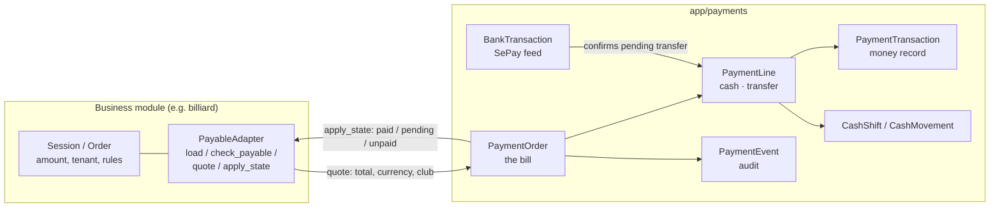
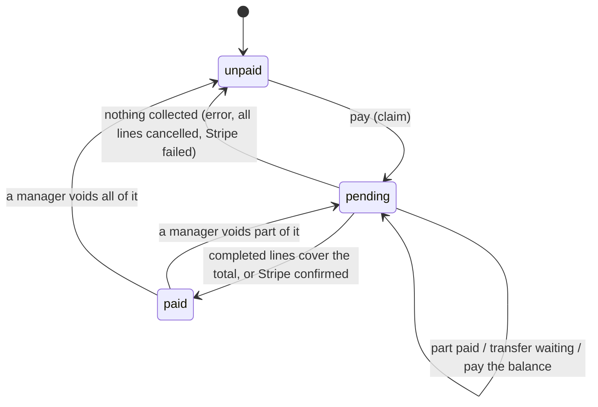

# Payments Module

Takes payment for **any business object**: cash with change, bank transfer with a VietQR, split
payments, Stripe, manager voids, a cash drawer with shifts, and automatic confirmation of bank
transfers from SePay. Billiard is the first business using it; a shop order, a ticket sale or an
invoice can use the same code by writing a small adapter.

> **The rule:** a business module owns *what is being paid and how much*. This module owns
> *how it gets paid*. Billiard has no cash, QR, bank-feed, shift or void code of its own.

---

## 1. How it fits together



- The business gives Payments a **quote** (total, currency, club) every time. The amount is never
  accepted from the client and never trusted from an old snapshot.
- Payments creates one `PaymentOrder` per business object (`source_type` + `source_id`), splits it
  into `PaymentLine`s, and writes each line's money to `PaymentTransaction` (the existing provider
  records for `manual` and `stripe`).
- Whenever the order changes state, Payments calls `apply_state` so the business object keeps a
  cheap mirror (`paid` / `pending` / `unpaid`, method, paid time). Reports on the business side
  then never need to join Payments tables.

## 2. Folder structure

```text
app/payments/
├── config.py                  # all payment settings (PAYMENT_*, SEPAY_*, Stripe)
├── models/
│   ├── payment.py             #   PaymentTransaction (the money record, per provider)
│   ├── order.py               #   PaymentOrder, PaymentLine, PaymentEvent
│   ├── shift.py               #   CashShift, CashMovement
│   └── bank_transaction.py    #   BankTransaction (every transfer SePay reports)
├── schemas/                   # payment.py · order.py · shift.py · bank_feed.py
├── providers/stripe_provider.py
├── services/
│   ├── payable_registry.py    # the contract a business implements (PayableAdapter, Quote)
│   ├── order_service.py       # pay / split / confirm / cancel / void / events
│   ├── shift_service.py       # cash drawer
│   ├── bank_feed_service.py   # SePay matching + manager workflow
│   ├── manual_service.py      # provider "manual" (cash, transfer)
│   ├── stripe_service.py      # provider "stripe"
│   ├── provider_registry.py   # provider name -> service
│   └── payment_service.py     # plain CRUD over PaymentTransaction
├── routes/                    # order_router · shift_router · bank_feed_router · payment_router
└── utils/                     # vietqr.py · sepay.py · money.py · permissions.py
```

## 3. Make a business payable (the only thing a new module writes)

```python
# app/shop/services/payment_adapter.py
from app.payments.services.payable_registry import Quote, payable_registry

class ShopOrderPayable:
    source_type = "shop_order"

    def load(self, db, source_id, user, *, lock=True):
        """The order, or HTTPException(404). user=None is a system caller (bank feed): skip the tenant check.
        lock=True must take a row lock (with_for_update)."""

    def check_payable(self, order):
        """HTTPException(409) if it cannot take a payment now (e.g. not confirmed yet)."""

    def quote(self, order) -> Quote:
        return Quote(client_id=order.client_id, currency="VND", total=order.total,
                     metadata={"shop_order_id": order.id})   # copied into every payment for reconciliation

    def apply_state(self, db, order, payment_order):
        """Mirror payment_order.state / method / paid_at / paid_by_id onto the order. No commit."""

payable_registry.register(ShopOrderPayable())    # import this module once at startup
```

That is enough for `/payments/orders/shop_order/{id}/...` to work with cash, change, split, QR,
bank feed, void and audit. A business can also keep its own URLs and call
`payment_order_service` directly (billiard does: `POST /sessions/{id}/pay`).

**Lock order:** always the business object first, then the order. Keep it that way to avoid deadlocks.

## 4. Data model

| Table | What it holds |
|-------|---------------|
| `payment_orders` | One bill per `(source_type, source_id)`: club, currency, total snapshot, state (`unpaid`/`pending`/`paid`), method (`cash`, `bank_transfer`, `stripe`, `split`), paid time and by whom |
| `payment_lines` | One row per part of the bill: method, amount, status, cash tendered / change, transfer memo and expiry, who recorded / confirmed / voided it |
| `payment_events` | Append-only audit trail with actor and JSON payload |
| `payment_transactions` | The money record per provider (already existed); lines link to it by `payment_id` |
| `cash_shifts`, `cash_movements` | Cash drawer: one open shift per club, pay-ins and pay-outs |
| `bank_transactions` | Every incoming transfer from SePay, stored before matching (unique per SePay id) |

Line statuses: `pending` (transfer waiting) → `completed` → `voided` (manager reversed it);
`cancelled` (never received) and `failed` (could not be recorded).

Audit event types: `line_created`, `cash_received`, `transfer_awaiting`, `transfer_confirmed`,
`transfer_auto_confirmed`, `transfer_assigned_from_bank`, `line_cancelled`, `line_failed`,
`line_voided`, `order_paid`.

## 5. Paying

### Request (`POST /payments/orders/{source_type}/{source_id}/pay`)

Send **exactly one** of `payment_method` or `payments`:

```json
{"payment_method": "cash", "cash_tendered": 500000}
```

```json
{"payments": [
  {"method": "cash", "amount": 200000, "cash_tendered": 200000},
  {"method": "bank_transfer", "amount": 110000}
]}
```

- For a split, the line amounts must add up **exactly** to the amount due (`422` otherwise).
- `cash_tendered` must be at least the cash amount; the server calculates `change_given`.
- Up to 6 lines. Stripe is one payment for the whole bill and cannot be mixed with other lines.
- The response shows `total`, `amount_paid`, `balance_due` and every line.

### Methods

| `method` | Provider | Result |
|----------|----------|--------|
| `cash` | `manual` | Paid immediately, with tendered / change |
| `bank_transfer` | `manual` | `pending` with a VietQR until the cashier or the bank feed confirms |
| `stripe` | `stripe` | `pending` until `POST .../pay/confirm` |

### States



### Why there is a "claim"

The providers call `db.commit()` themselves, so everything cannot be wrapped in one transaction.
Instead: (1) lock the business object and the order, insert the lines, flip the order to `pending`,
mirror it onto the business object and **commit**; (2) call the provider once per line, so a
concurrent pay gets `409`; (3) settle the order from its lines. A failure leaves lines marked
`failed` and the order shows exactly what was recorded; pay the balance again to continue.
Each payment's metadata carries `payment_order_id` plus the business keys from the quote, so a
human can always reconcile.

### Bank transfer (VietQR)

1. `pay` creates a `pending` transfer line with a memo `<PREFIX><order>L<line>`, for example `PAY12L34`.
   The response has `payments[].transfer`: `qr_payload` (draw as a QR code), `qr_image_url`, memo,
   amount and `expires_at`.
2. The customer scans and pays.
3. Either the cashier presses "received" (`POST .../lines/{line_id}/confirm`) or the bank feed
   confirms it automatically (section 7).
4. If the money never comes: `POST .../lines/{line_id}/cancel`. The balance can be paid another way.

## 6. Voids and the cash drawer

**Void (managers/admins only).** `POST .../lines/{line_id}/void` with a reason (3+ characters)
reverses a completed line: the payment record becomes `refunded`, the order goes back to part-paid
or unpaid and can be paid again, and the event is audited. Cashiers get `403`.

**Shifts.** One drawer per club, one open shift at a time.

```text
POST /payments/shifts/open        {"opening_float": 1000000}
GET  /payments/shifts/current     live totals, or null
POST /payments/shifts/{id}/movements  {"type": "pay_out", "amount": 20000, "reason": "bought ice"}
POST /payments/shifts/{id}/close  {"counted_cash": 1290000}   -> expected, counted, variance
GET  /payments/shifts, GET /payments/shifts/{id}
```

- Expected cash = opening float + cash received − cash voided + pay-ins − pay-outs. Change given back
  is not in the drawer, and transfers are reported per method but are not drawer cash.
- Cash taken or voided during the open window is derived from `payment_lines` of the same club,
  so any business that pays through this module shows up in the drawer.
- Expected, counted and variance are frozen at close. A void after close counts as money out of the
  *next* shift.
- By default payments are allowed with no shift open. Set `PAYMENT_REQUIRE_OPEN_SHIFT=true` to refuse
  (`409`) until a shift is open.
- Only the opener or a manager can close a shift.

## 7. Automatic confirmation of transfers (SePay)

[SePay](https://developer.sepay.vn/en/sepay-webhooks) watches the receiving bank account and calls
`POST /payments/bank-feed/sepay` for every incoming transfer.

**Set up**

1. In SePay add a webhook to `https://<your-api>/payments/bank-feed/sepay` (HTTPS, public domain).
2. Choose the security method and set the matching variable:
   - HMAC-SHA256 (preferred): `SEPAY_WEBHOOK_SECRET`. Verifies `X-SePay-Signature` over
     `<X-SePay-Timestamp>.<raw body>` and rejects timestamps more than 5 minutes off.
   - API key: `SEPAY_API_KEY`. Verifies `Authorization: Apikey <key>`.
   - If neither is set the endpoint answers `503` and stays closed. If a secret is set, an
     API-key-only request is rejected.
3. Set `PAYMENT_BANK_ACCOUNT_NO` to the account SePay watches. Transfers to any other account are ignored.
4. Optional: if you use SePay's *Payment code structure*, use the same prefix as `PAYMENT_MEMO_PREFIX`
   (default `PAY`). Matching does not depend on it: we search the transfer content for our own code
   (any case, any surrounding text) and also check SePay's `code` field.

**What happens to each transaction.** It is stored first in `bank_transactions` (unique per SePay `id`,
so replays are harmless), then matched:

| Result | When | What happens |
|--------|------|--------------|
| `matched` | Code found, line still `pending`, amount **exactly** equal | Line completes, order settles, audit event `transfer_auto_confirmed` (no user) |
| `needs_review` | Code found but amount differs, line already paid (possible double transfer), or line cancelled/voided | Nothing is confirmed; a manager decides |
| `unmatched` | No code in the content, or the code matches no line | Kept for a manager |
| `ignored` | Outgoing transfer, or another account | Kept for audit |

The webhook always answers `{"success": true}` once an authenticated transaction is stored, even if
it could not be matched; SePay treats anything else as a failure and retries for up to 5 hours.

**Manager tools**

- `GET /payments/bank-feed/transactions?status=needs_review`
- `POST /payments/bank-feed/transactions/{id}/assign` `{"line_id": 7}`: link a transaction to a
  pending transfer line and confirm it (exact amount only, `422` otherwise).
- `POST /payments/bank-feed/transactions/{id}/ignore` `{"note": "refunded"}`

Unmatched transactions carry no club (the receiving account is global configuration), so every
manager can see them; matched and `needs_review` ones are scoped to the club of their bill.

> **Not covered yet:** SePay stops retrying after 5 hours. Their advice is a job every 15-30 minutes
> that fetches recent transactions through their API and feeds missing ones through the same matcher.
> The cashier's "received" button is the fallback meanwhile.

## 8. Configuration

Each `PAYMENT_*` variable falls back to the older `BILLIARD_*` name, so existing deployments keep working.

| Variable | Default | Meaning |
|----------|---------|---------|
| `STRIPE_API_KEY`, `STRIPE_WEBHOOK_SECRET` | empty | Stripe |
| `PAYMENT_BANK_TRANSFER_REQUIRES_CONFIRMATION` | `true` | A transfer waits for confirmation. `false` = paid immediately, like cash |
| `PAYMENT_TRANSFER_EXPIRE_MINUTES` | `15` | How long a transfer QR is shown as valid |
| `PAYMENT_MEMO_PREFIX` | `PAY` | Prefix of the transfer content that identifies a line (letters/digits) |
| `PAYMENT_BANK_BIN` | empty | NAPAS bank BIN of the receiving account, e.g. `970436` |
| `PAYMENT_BANK_CODE` | empty | Short bank code, e.g. `VCB` (only for the hosted QR image URL) |
| `PAYMENT_BANK_ACCOUNT_NO` | empty | Receiving account number |
| `PAYMENT_BANK_ACCOUNT_NAME` | empty | Account holder name shown to the customer |
| `PAYMENT_REQUIRE_OPEN_SHIFT` | `false` | `true` = taking a payment needs an open shift |
| `SEPAY_WEBHOOK_SECRET` | empty | HMAC secret for the SePay webhook (preferred) |
| `SEPAY_API_KEY` | empty | API key alternative; the endpoint is closed if neither is set |
| `SEPAY_TIMESTAMP_TOLERANCE_SECONDS` | `300` | Allowed clock difference for HMAC requests |

Without `PAYMENT_BANK_BIN` + `PAYMENT_BANK_ACCOUNT_NO` no QR is generated; a transfer line still works
and the cashier confirms it by hand.

> Changing `PAYMENT_MEMO_PREFIX` only affects **new** transfer lines. A transfer already waiting keeps
> its old memo, which the matcher no longer recognises (it shows up as `unmatched` for a manager).

## 9. API reference

All endpoints need a logged-in user (JWT) unless noted. `{source_type}` is the business, e.g. `billiard_session`.

### Orders

| Method | Path | Role | Description |
|--------|------|------|-------------|
| `GET` | `/payments/orders/{source_type}/{source_id}` | any user of the club | Total, paid, balance and every line |
| `POST` | `/payments/orders/{source_type}/{source_id}/pay` | any user | Pay in one go or split |
| `POST` | `/payments/orders/{source_type}/{source_id}/pay/confirm` | any user | Settle a Stripe payment |
| `POST` | `/payments/orders/{source_type}/{source_id}/lines/{line_id}/confirm` | any user | Cashier confirms a transfer arrived |
| `POST` | `/payments/orders/{source_type}/{source_id}/lines/{line_id}/cancel` | any user | Void a pending line |
| `POST` | `/payments/orders/{source_type}/{source_id}/lines/{line_id}/void` | ADMIN, MANAGER | Reverse a completed line (reason required) |
| `GET` | `/payments/orders/{source_type}/{source_id}/events` | any user | Audit trail |

### Shifts

| Method | Path | Description |
|--------|------|-------------|
| `POST` | `/payments/shifts/open` | Open a shift with an opening float. `409` if one is open |
| `GET` | `/payments/shifts/current` | The open shift with live drawer totals, or `null` |
| `GET` | `/payments/shifts` | Recent shifts (`limit`, `offset`) |
| `GET` | `/payments/shifts/{id}` | Shift summary: drawer maths, per-method totals, movements |
| `POST` | `/payments/shifts/{id}/movements` | Pay-in / pay-out with a reason |
| `POST` | `/payments/shifts/{id}/close` | Close with the counted cash; returns the variance |

### Bank feed (SePay)

| Method | Path | Auth | Description |
|--------|------|------|-------------|
| `POST` | `/payments/bank-feed/sepay` | SePay HMAC or API key | Webhook for incoming transfers |
| `GET` | `/payments/bank-feed/transactions` | manager | List; filter with `?status=` |
| `POST` | `/payments/bank-feed/transactions/{id}/assign` | manager | Link to a pending transfer line and confirm it |
| `POST` | `/payments/bank-feed/transactions/{id}/ignore` | manager | Dismiss |

### Legacy

`/payments/` (list, create, `PATCH /{id}`), `/payments/client/{id}`, `/payments/user/{id}` and
`/payments/stripe/create|confirm/{ref}|refund/{ref}` are unchanged. They work on `PaymentTransaction` records, below the order layer.

### Error codes

| Code | Typical reason |
|------|----------------|
| `403` | A non-manager tried to void, assign a bank transaction, or close someone else's shift |
| `404` | Unknown source or line, or it belongs to another club (never `403`, so ids are not leaked) |
| `409` | Wrong state: not payable yet, already paid, payment in progress, nothing to pay, no open shift |
| `422` | Split lines do not add up, cash tendered below the amount, void without a reason |

## 10. Upgrading an existing database

Run once: `python migrate_payments_orders.py`. It is idempotent, backs up SQLite first, creates the
payment tables, adds `table_sessions.payment_order_id`, and **deletes the old demo payment lines,
events and bank transactions** (`session_payments`, `session_payment_events`, `bank_transactions`
with the old shape). Sessions already `paid` stay paid; sessions left `pending` by a deleted line are
reset to `unpaid`. A fresh database gets everything from `init_db`.

## 11. Tests

| File | What it covers |
|------|----------------|
| `test_payments_orders.py` | Cash, change, split, VietQR, cancel, void, Stripe, audit, tenant checks, against a **fake business** |
| `test_payments_shifts.py` | Shifts, drawer maths, variance, pay-in/out, voids and the drawer |
| `test_payments_bank_feed.py` | SePay auth, replays, matching rules, races, manager tools, webhook over HTTP |
| `test_stripe_provider.py` | Zero-decimal currencies, rounding, refunds |
| `test_billiard_payments.py` | Only billiard's side: adapter rules, state mirror, legacy sessions, URLs |

`app/tests/payments_testkit.py` holds the fake business and shared fixtures. If you add a business
module, give it one small integration test like `test_billiard_payments.py`; the payment rules are
already covered here.
